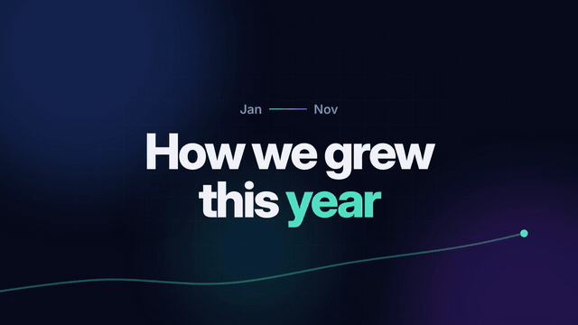

<picture>
  <source media="(prefers-color-scheme: dark)" srcset="docs/media/logo/wordmark-dark.svg">
  
</picture>

# givemotion: make videos with AI, free and open source

**Ask your AI agent for a video and get a finished MP4.** givemotion lets AI agents like Claude Code, Codex and
Cursor make motion graphics for you: launch videos, explainers, animated charts, social shorts, title sequences. You
describe the video in plain words. The agent builds it, looks at its own frames, fixes what's off and renders the
file. Then you ask for changes the way you'd ask a motion designer, and only what you asked about changes.

It's free and open source (MIT): no account, no seats, no fee per video, and you can fork it and make it your own.

Created by [Leonardo Grigorio](https://github.com/leonardogrig) as an independent project. Website:
[givemotion.org](https://givemotion.org). (Formerly called motionwright.)

If you are looking for a way to **make videos with Claude Code**, an **AI motion graphics tool you can run in your own
project**, or a **free, open-source way to make videos with code**, this is it.

<p>
  
  
</p>
<p>
  
</p>

*Each of these was made by a Claude agent from a one-paragraph brief, using only this project's docs.
The data story is in [`examples/data-story`](examples/data-story); more are in [`examples/`](examples).*

---

## How it differs from AI video generators

AI video generators (the models that turn a prompt into a clip) paint every frame from scratch. That's what you want
for footage of things that were never filmed. It gets hard when you need one specific video: ask for one word to be
fixed and the model makes the whole clip again, and something else comes out different. Text gets misspelled, logos
get warped, and every attempt is paid for.

givemotion works the way a motion designer works. The agent builds the video out of real pieces (your logo file,
your fonts, your exact words and numbers, shapes, illustrations, a camera, your music), and givemotion plays it back
and records it frame by frame. For you that means:

- **The same video every time.** Render it again tomorrow and you get the same video. Nothing drifts between
  versions.
- **Change one thing and only that changes.** "Make the title blue" turns the title blue and leaves the rest exactly
  as you approved it. Only the stretch of video the change touches is rendered again, so a small fix usually takes
  seconds.
- **Text and logos come out right.** Words are typeset, not drawn by a model, so they're sharp and spelled the way
  you wrote them. Your logo is your actual file.
- **Cheap to make and to change.** It renders on your own computer, with no fee per second of video. You pay
  for your AI agent as you already do; givemotion itself costs nothing to run.
- **Many versions from one video.** Swap the name, the numbers or the language and render as many copies as you
  need.
- **You keep the source.** The video is saved as a project file. Your agent can open it next month and change the
  price, the date or the ending.

Under the hood, the agent writes the video as code, the same kind web pages are made of. That's why every change can
be exact. You never have to read it or touch it; the agent does that part. (If you're a developer: it's plain HTML,
CSS and JavaScript, and [For developers](#for-developers) has the details.)

What it doesn't do is generate footage. It can't film a photorealistic dog on a beach. It makes designed motion:
type, shapes, illustrations, charts, app screens, and the photos and video clips you give it. If you need generated
footage, make it with a video model and have the agent put the clip into a givemotion video.

## Try it in 1 minute

In your project folder, run:

```bash
npx givemotion init my-video
```

If you'd rather not use the terminal, ask your agent to do it: "Set up givemotion in this folder." Either way you get
a starter video and the instructions your agent needs. Then ask for the video you want:

> "Make a 20-second launch video for our app. Use our logo and colors, and put music under it."

The agent writes the video, runs the checks, looks at the frames, fixes what is wrong, and renders
`out/video.mp4`. You can watch and scrub it live with `npx givemotion dev my-video`.

Then ask for changes the way you would ask a motion designer: "make the title blue", "hold the chart two seconds
longer". The agent edits the video and renders again, and only the parts that changed are redone.

Already have a project? `npx givemotion skill` adds just the agent instructions: a skill pack (a short
`SKILL.md` plus topic files the agent reads when it needs them) in `.claude/skills/givemotion/` for Claude Code and
`.agents/skills/givemotion/` for Codex, and a section in `AGENTS.md` for Cursor and other agents. Run it again after
updating givemotion; `npx givemotion doctor` tells you when the installed pack is older than the engine.

Other ways to install the skill:

- Claude Code plugin: `/plugin marketplace add givemotion/givemotion`, then `/plugin install givemotion@givemotion`
- Skills CLI (Claude Code, Codex, Cursor and more): `npx skills add givemotion/givemotion`

**You need:** Node.js 20+ and ffmpeg. Chrome is downloaded for you (`npx givemotion install`).

## What you can make

- Product launch videos and app promos (with a cursor that really clicks the right button)
- Explainers with a camera that moves over a map, a diagram or a whole UI
- Hand-drawn whiteboard (Excalidraw-style) explainers: sketchy shapes and arrows that draw themselves on, handwriting
- Animated charts and data stories, from your own numbers
- Vertical shorts for TikTok, Reels and YouTube Shorts, with word-by-word captions
- Code explainers for developer channels
- Logo stings, title cards, lower thirds, end cards
- Many personalized videos from one template (a different name, number or logo in each)
- Transparent overlays to drop into Premiere, DaVinci Resolve or Final Cut

## Same brief, different models

Each model got the same brief and only this project's docs. "The last lighthouse" asked for a 15 s cinematic title
sequence: a night sea, and a light beam that carries into the title.

| Claude Opus 5.5 | Claude Sonnet 5.5 |
|---|---|
|  |  |
| **Claude Haiku 5.5** | **Gemini 4 Argon** |
|  |  |

A later round with Claude Opus 5.5, Sonnet 5.5, Haiku 5.5 and Fable 5.1, "Code in, motion out": 20 s in one
continuous take, a typed `<motion>` that breaks into 3D shapes, a tilted orbiting ring, a collapse into the title
([the experiment](docs/experiments/2026-10-models-showcase.md)).


### Same model, four effort levels

Claude Opus 5.5 at effort low, medium, high and xhigh, each in a fresh session with the same prompt, made one
illustrated 20 s short: a dog's morning walk with a walk cycle, a gallop, a leap over a puddle and a title. Eight
blind AI judges scored them ([the experiment](docs/experiments/2026-11-efforts-showcase.md)).


| | low | medium | high | xhigh |
|---|---|---|---|---|
| Judges' overall (1-10) | 5.3 | 6.9 | 6.6 | **8.0** |
| Tokens / tool calls | **0.6M / 13** | 5.1M / 39 | 5.0M / 34 | 30.8M / 110 |
| Cost at API prices / minutes | **$1.15 / 5** | $4.06 / 17 | $4.43 / 20 | $14.46 / 53 |

xhigh was first for 7 of 8 judges. Medium was the best value. Low framed the dog too small to read and looked at
its own frames only four times. One brief and one run per level, so read it as a showcase, not a benchmark.

## Why it exists

I started givemotion because of how AI video models handle changes. When one detail is wrong, you ask again and
the model makes the whole video again, and something else often comes out different. With code, a change is an edit:
the agent changes one color or one timing and everything else stays exactly as it was. I wanted an engine built
around that loop, where the agent writes, checks, looks and fixes, and where a small fix costs a small render.

I also wanted it to be free for everyone without conditions. Companies of any size, agencies, people building their
own video tools on top of it: MIT allows all of that, including selling a modified copy.

It's an independent project, not tied to any company, and it's young. It gets better in rounds: fresh agents make
real videos from the docs, I read where they got stuck, and the engine is fixed. What it can't do yet is listed
below, next to what it can.

Leo

## Why it works well with AI agents

Most video tools were made for people. AI agents work differently, so givemotion is built around how they actually
behave, and we test it with real agents instead of guessing.

**1. Change one thing, render one part.** A render is split into fixed parts of 1 to 2 seconds, each with a
fingerprint of everything that can affect its pixels. Render again after an edit and only the parts whose fingerprint
changed are redone. Edit one scene and only that scene's parts are rendered; in one long scene, an edit to something
that first appears at 40 s keeps the first 40 s. The result is byte-identical to a full render. There are limits:
a script that reads the whole page, for example, turns the finer reuse inside a long scene off, and the render
report says why.

**2. It uses what AI already knows best: web pages.** A video is one HTML file with normal CSS and JavaScript.
Models have seen billions of web pages, so they write them well. In our test, 12 Claude agents made the same 4 videos
in plain HTML, in HTML with ready-made blocks, and in React; blind AI judges ranked plain HTML first in 6 of 8 cases,
with React a little behind ([the experiment](docs/experiments/2026-10-format-test.md)). That's a small test, and
it agrees with outside research (DesignBench, 2025) that models do best with plain HTML and CSS.

**3. The agent can check its own work.** An agent can't watch a video, so the engine does it for them:
- `check` finds text that is cut off, off screen, covered, overlapping, too small or hard to read, lines running
  through labels, two scenes' text smudged together in a transition, broken files and script errors, and says how
  to fix each one. It knows the difference between text that is *moving* past the edge and text that is *stuck* there.
- It also flags pacing: long stretches where nothing happens, a dead end card, an empty opening, an element that
  leaves before you could read it, or a camera move that only arrives after its scene has started to leave.
- It prints a "motion strip", a one-line picture of the video's rhythm.

**4. It picks the frames worth looking at.** `snapshot` reads the timeline and chooses the moments itself: each scene
once its entrances are done and before it starts to leave, and each camera shot once the camera has arrived. It puts
them in one image, so the agent sees the whole video in one look instead of guessing timestamps. `analyze` does the
same for any video file, including a reference you want to match, and `--compare` lists how yours differs.

**5. Motion design, not slides.** The tools that make video feel like animation are built in, so the agent doesn't
have to write them: a camera that follows and frames things, motion along paths, shape morphs, shared elements that
fly from one scene into the next, more than 25 scene transitions, kinetic type, particle bursts, live data charts the
camera can ride, hand-drawn sketch shapes and arrows that draw themselves on, labels that stay attached to their
shapes, and cuts and pulses that land on the music's beats. Because these are built in, agents write little code:
a median of about 240 lines per video in our agent tests.

**6. Natural motion by default.** Entrances spring in and settle, diagonal moves travel on a slight arc, exits
accelerate away, and the camera moves like an operator (back-to-back shots flow into one move, `follow` trails its
target and settles). `<html data-motion="classic">` brings back plain curves. We are still working out how to
measure whether viewers see the difference; so far our AI judges, who look at stills, don't.

**7. The know-how of a motion designer, in the agent's docs.** The skill pack has a short core plus files the
agent reads only when it needs them: 15 technique recipes (kinetic type, camera moves, scene transitions, logo
reveals, charts, UI demos, hand-drawn...), each checked by rendering it; 8 ready-made looks (palette, fonts,
background, motion personality); and guides for 9 kinds of video. Seven fonts are built in (Inter, JetBrains Mono,
Playfair Display, Space Grotesk, Bebas Neue, Nunito, Caveat), so a video looks the same on every machine.

**8. Built from what agents struggled with.** We give fresh agents only the docs and a real brief, read their
notes on what got in their way, and fix the engine, not just the instructions. In the latest full round, 18 agents
made 9 kinds of video (promo, explainer, data story, UI demo, whiteboard, code explainer, logo sting, year recap,
vertical short); blind AI judges gave them 7.1 out of 10 on average, none below 6, and their notes led to about 20
engine fixes. Every round and what it changed is in [`docs/experiments/`](docs/experiments/).

**9. Same input, same video.** Frames are a pure function of time, and 1 worker and N workers produce the same bytes;
the test suite checks it. That is what makes the reuse in point 1 safe. One known case still differs on macOS: there
Chrome draws on its own clock, and on a busy machine a layer whose scale keeps changing (with text moving nearby)
can come out slightly different between renders. On an idle machine renders match. It's on the fix list.

**10. Small and private.** givemotion has zero npm dependencies (installing it adds one package), sends no usage
data, and never needs an account. It renders wherever Node runs, and once Chrome is installed it works offline.

## What it doesn't do yet

- **No cloud rendering.** It renders on your machine or your server.
- **No visual editor.** `givemotion dev` is a preview (timeline, scrubbing, frame stepping, sound), not an editor.
  Your agent is the editor.
- **No voice or transcription tools.** Bring your own voice-over and a word-timed captions file or `.srt`.
- **No HDR or HLS output.**
- **Slow on heavy pages without a GPU.** Pages with many full-screen effects render slowly on machines without one.
- **Speed on a Mac is not benchmarked yet.** All our timing numbers come from Linux cloud machines (see Performance).
- **It's new.** The community is small, and options may still change between 0.x versions.

## Make your own version (fork it)

MIT means you can take this and build on it, keep your fork private, or sell it. The only condition is that the
license notice stays in. One idea we like: **a fork focused on one style.** For example a "whiteboard" edition, a
"tech launch" edition, or your company's brand edition:

1. Fork the repo.
2. Add blocks in [`blocks/`](blocks) for your style: your title cards, your lower thirds, your charts, your
   transitions, in your colors and fonts. Put your fonts in `src/runtime/fonts/`, with an `@font-face` for each in
   `src/runtime/preset.css`, so every render has them.
3. Add your look to the agent instructions. [`skills/givemotion/references/styles.md`](skills/givemotion/references/styles.md)
   holds the built-in looks; add yours with the blocks to use, the colors, the fonts, the motion personality and what
   to avoid. Point to it from [`SKILL.md`](skills/givemotion/SKILL.md) so the agent reads it first.
4. Ship it with `npx givemotion skill` (or your own package name), so your team's agents get your edition.

Agents then make videos in that style faster and more consistently, because they start from pieces that already look
right instead of inventing everything each time. You get most of what people hope for from "fine-tuning a model on
our brand", without training anything.

For a single project you may not need a fork: copy blocks into the project with `npx givemotion add <name>`, edit them
to your brand, and write your rules into the project's `AGENTS.md`.

## Where it's going

givemotion is maintained as an independent project and improved in rounds: agents make real videos, judges score
them, and what went wrong becomes engine fixes and better docs. The open work is public in
[`docs/NEXT.md`](docs/NEXT.md). Near the top of the list:

- publish the agent-test method and a harness anyone can run on their own briefs;
- benchmark render speed on a Mac;
- fix the open macOS determinism case;
- lower the token cost per video for agents;
- find a fair way to measure whether natural motion looks better.

If you use it, the most useful thing you can send is a video that came out wrong, with the HTML. Issues and pull
requests are welcome.

## Questions people ask

**Is this an AI video generator?** No. It doesn't generate footage from a prompt. Your agent builds the video from
real pieces (your text, logo, fonts, images, clips, data) and givemotion renders it. That's why the result is the
same every time, a change touches only what you asked about, and text is spelled the way you wrote it. See
[How it differs from AI video generators](#how-it-differs-from-ai-video-generators).

**Is there a free, open-source way to turn code into video?** Yes. givemotion is MIT licensed: free for any use,
including companies of any size, with no account, seats or fee per render.

**What makes it different from other code-to-video tools?** It is written for AI agents first: plain HTML and CSS,
an engine that checks its own frames and tells the agent what to fix, re-rendering only what changed, no
dependencies, no telemetry, no account, and independence from any company. What it doesn't do yet is listed in
[What it doesn't do yet](#what-it-doesnt-do-yet).

**Can Claude Code make videos?** Yes. Run `npx givemotion init` (or `npx givemotion skill` in an existing
project) and ask Claude Code for a video. It also works with Cursor, Codex and other agents that read an
`AGENTS.md` file.

**If I don't like one part, does the whole video render again?** No. The agent edits that part, and only the 1-2
second pieces of the video that changed are rendered again. The result is the same file you would get from a full
render.

**Do I need to know how to code?** No. You talk to your agent in plain words and it does the rest, including the
setup if you ask it to. The code is there so that every change is exact; you don't have to look at it. If you do know
HTML and CSS, you can open the file and change anything.

**How much does it cost?** givemotion is free. You pay for your AI agent as you already do (a subscription or
tokens), and rendering runs on your own computer. A change re-renders only the part of the video it touches,
so revisions stay cheap.

**Can I use it for client work or commercially?** Yes, for free, at any company size. MIT license.

**Can I build my own video product on it?** Yes. You can embed it, run it on your servers, fork it and sell the fork.

**Can I put my own music, voice-over, logos and videos in?** Yes. Audio tracks with volume curves and ducking
under a voice, video clips, images, fonts, and captions from a word-timed file or an `.srt`.

**How fast is it?** Fast on a normal computer, faster with more cores and a GPU. It renders with several browsers
at once, skips frames that did not change, and re-renders only the parts you changed. See [Performance](#performance).

**Who made it?** [Leonardo Grigorio](https://github.com/leonardogrig) started it in 2026. It's an independent
open-source project, and contributions are welcome.

---

## For developers

### A composition

```html
<!doctype html>
<html data-width="1920" data-height="1080" data-fps="30">
<head>
<style>
  body { background: #0b0d12; color: #fff; font-family: Inter, system-ui, sans-serif; }
  .scene { display: grid; place-items: center; }
  h1 { font-size: 120px; margin: 0; }
</style>
</head>
<body>
  <main data-sequence data-transition="fade 0.6">
    <section class="scene" data-duration="3" data-camera="push 1.1">
      <h1 data-enter="rise">Hello</h1>
    </section>
    <section class="scene" data-duration="4">
      <h1 data-split="words" data-enter="fade-up 0.6" data-stagger="0.08">Any HTML. Any CSS.</h1>
      <audio src="music.mp3" data-volume="0.4" data-fade-out="1"></audio>
    </section>
  </main>
</body>
</html>
```

No imports and no build step: the runtime is added for you. Everything that moves on a web page is played
on a virtual clock and captured frame by frame: CSS animations, transitions, the Web Animations API, timers,
`requestAnimationFrame`, canvas, WebGL, GSAP, Lottie. There is also a built-in GSAP-style timeline
(`gm.timeline()`), a camera (`gm.camera()`), path travel, shape morphs, `gm.fly()` (move an element in from where
another one is), live line charts (`gm.chart.line()`), hand-drawn shapes (`data-sketch`), labels pinned to shapes
(`data-anchor`), particle bursts, and music analysis (`gm.audio()`, `gm.beat(n)`, `data-pulse`, cuts written in beats).

The full reference is the skill pack written for agents (and good for humans too):
[`skills/givemotion/SKILL.md`](skills/givemotion/SKILL.md) and the topic files in
[`skills/givemotion/references/`](skills/givemotion/references).

### Commands

| Command | What it does |
|---|---|
| `init [dir]` | New project: starter video, agent instructions, AGENTS.md |
| `skill` | Add the agent instructions to an existing project |
| `dev [file]` | Live preview with a timeline, scrubbing, frame stepping and sound |
| `render [file] -o out.mp4` | Render to `.mp4` `.webm` `.mov` `.gif`, a folder of PNGs, or just the soundtrack (`.mp3`) |
| `still [file] -t 2.5 -o f.png` | One exact frame |
| `check [file]` | Problems with fixes, plus the motion strip |
| `snapshot [file]` | Key moments of every scene in one image |
| `review [file]` | The video as a viewer sees it: overview, the frames people read, motion strips at the busy moments, the check report and a scoring rubric (`review/REVIEW.md`) |
| `inspect [file]` | Timeline as JSON; `--at 3.2 --el "#logo"` says where anything is at any moment |
| `audio <file>` | Tempo, beats, bar starts and big hits of a song |
| `captions <file>` | The caption pages a word-timed `.json` or `.srt` will show, so you can pick how many words per page |
| `analyze <video.mp4>` | Report on any video (a reference, or your render): shots and cuts, transitions, camera, pacing, colors, cuts on the beat, contact sheets. `--compare ref.mp4` lists how yours differs |
| `bundle [file] -o dir` | Standalone page + `<gm-player>` to embed the video in any site |
| `blocks` / `add <name>` | Ready-made blocks you can copy and edit |
| `install` / `doctor` / `bench` | Get Chrome, check your setup, measure speed (and what makes a page slow to draw) |

Render options: `--quality draft|standard|high|max`, `--fps`, `--scale 2` (4K from a 1080p layout; `4/3` for 1440p),
`--frames 2s-5s`, `--transparent`, `--motion-blur 8|auto`, `--codec h265|av1`, `--hardware`, `--workers`,
`--muted`, `--data file.json`, `--props '{…}'`, `--cache-dir <dir>` (where the parts cache lives),
`--progress json` (JSON progress lines on stderr, for apps). Every command takes `--json`.

Renders running at the same time (several projects, several agents) share the computer: together they open no more
browsers than it has performance cores and use at most half its memory, split evenly between them, so starting
another one does not freeze the machine. `GIVEMOTION_MAX_BROWSERS=N` changes the total.

Rendering again after a change only redoes the parts of the video that changed (edit one scene → only its 1-2 s parts
are rendered; in one long scene, an edit to something that appears at 40 s keeps the first 40 s), and the result is
byte-identical to a full render. `--redo 4s-7s` forces a range, `--no-cache` turns it off. The render result says
how many parts were reused, and `parts.lateOff` says why the finer reuse inside a long scene was turned off, if it was.

### Programmatic API

```js
import { render, check, snapshot, still, inspect } from 'givemotion';

await render('video.html', { output: 'out/video.mp4', quality: 'high', data: { name: 'Ada' } });
const report = await check('video.html');           // { ok, errors, warnings, issues: [...] }
const { sheet } = await snapshot('video.html');     // path to the contact sheet
```

TypeScript types ship with the package (`RenderOptions`, `RenderResult`, `CheckReport`, `Issue`, ...), so your
editor and your agent see every option and catch a misspelled one. givemotion itself is plain JavaScript checked by
TypeScript from JSDoc, so there is no build step.

### Blocks

Plain-HTML building blocks you copy into your project and edit freely (`npx givemotion add <name>`):
title-card, lower-third, captions, code-window, bar-chart, line-chart, stat, checklist, steps, browser-window,
phone, cursor, callout, compare, quote, word-pop, logo-reveal, end-card, gradient-bg, grid-bg, lottie.

### Performance

Measured on a small cloud machine (2 CPUs, no GPU), 1080p at 30 fps, 300 frames:

| | Time |
|---|---|
| Simple approach: one browser, PNG screenshots, no frame reuse | 32.7 s |
| givemotion, 1 worker | 15.0 s |
| givemotion, auto workers | 13.3 s |

On a 4-CPU cloud machine without a GPU (October 2026), that same test page renders in 14.6 s (22.6 s with one
worker), and the 18 videos agents made in our latest test round (5 to 31 s long, 1080p) rendered at 18.8 frames per
second on average. Pages with many full-screen effects are slower on machines without a GPU. Run
`npx givemotion bench` on your own computer.

Where the speed comes from: Chrome's frame-by-frame capture (`beginFrame`, on Linux and Windows), several
browsers rendering parts of the video at once, reusing frames that did not change, re-rendering only the parts that
changed, and encoding while capturing.

**On a Mac** it uses the GPU for drawing, and the Mac's hardware video encoder (VideoToolbox) for MP4 by default,
once a quick one-time check shows the encoder gives the same bytes every time (so renders stay exact and re-renders
can reuse parts). `npx givemotion doctor` says which encoder you get; `--no-hardware` turns it off. Frame capture
on macOS uses screenshots, because Chrome's frame-by-frame capture is not available there. We have not published Mac
timings yet.

### How it works

```
HTML ──► local server (adds the runtime, expands blocks and {{data}}, serves video frames)
           │
           ▼
 headless Chrome × N  ── runtime: virtual clock, seeks every animation to the exact time
           │  capture each frame
           ▼
      ffmpeg × N (1-2 s parts, fingerprinted, reused when unchanged) ──► join + audio mix ──► out.mp4
```

### Requirements

- Node.js 20+
- ffmpeg on your PATH (`brew install ffmpeg`, `sudo apt install ffmpeg`, `winget install ffmpeg`)
- Chrome: `npx givemotion install` downloads it, or it finds the one you have

givemotion itself has **zero npm dependencies**: installing it adds one package.

### Status

givemotion is young (0.x). Compositions written today should keep working, but options and APIs may still
change between minor versions; changes are listed in the release notes.

## Contributing and security

Pull requests and issues are welcome: see [CONTRIBUTING.md](CONTRIBUTING.md) (and [AGENTS.md](AGENTS.md) for the
code layout). A composition is code that runs in Chrome; if you render compositions or data from people you don't
trust, read [SECURITY.md](SECURITY.md) first. Report security problems privately, as described there.

## License

MIT, copyright Leonardo Grigorio and givemotion contributors. Use it, change it, fork it, sell what you make with it.
The MIT license covers givemotion itself; Chrome and ffmpeg are installed separately under their own licenses. The
examples and the animations in this README were made for this project and are MIT too. The bundled fonts (Inter,
JetBrains Mono, Playfair Display, Space Grotesk, Bebas Neue, Nunito, Caveat) are under the SIL Open Font License (license
files in `src/runtime/fonts/`). Everything third-party is listed in [THIRD_PARTY_NOTICES.md](THIRD_PARTY_NOTICES.md).

givemotion was written from scratch and contains no code from other video tools. How we keep it that way is in
[CONTRIBUTING.md](CONTRIBUTING.md#independence-and-clean-room-policy).
