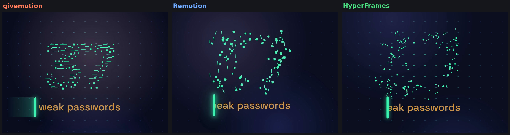

<picture>
  <source media="(prefers-color-scheme: dark)" srcset="docs/media/logo/wordmark-dark.svg">
  
</picture>

# givemotion: make videos with AI, free and open source

**Ask your AI agent for a video and get a finished MP4.** givemotion is a free, open-source (MIT) video engine that lets AI coding agents like **Claude Code**, **Codex** and **Cursor** make motion graphics for you: launch videos, explainers, animated charts, vertical shorts, UI demos and title sequences.

You describe the video in plain words. The agent builds it, looks at its own frames, fixes what is off, and renders the file. Then you ask for changes the way you would ask a motion designer, and only what you asked about changes.

It is free and open source (MIT): no account, no seats, no fee per video, zero npm dependencies, and you can fork it and make it your own. Created by [Leonardo Grigorio](https://github.com/leonardogrig) as an independent project (formerly called *motionwright*). Full research paper and test videos: **[givemotion.org](https://givemotion.org)**.

If you are looking for a way to **make videos with Claude Code**, an **AI motion graphics tool you can run in your own project**, or a **free, open-source way to make videos with code** (an MIT alternative to Remotion and HyperFrames), this is it.

<p>
  
  
  
</p>

*Each of these was made by a fresh Claude Opus agent from a one-paragraph brief, using only this project's docs (data story and vertical short: 24 October 2026, [round-3 remakes](docs/experiments/2026-10-t2-examples.md); lighthouse: 27 October 2026; `givemotion 0.1.0` pre-release). The data story is in [`examples/data-story`](examples/data-story); more are in [`examples/`](examples) and on **[givemotion.org](https://givemotion.org#videos)**.*

---

## Try it in 1 minute

In your project folder, run:

```bash
npx givemotion init my-video
```

If you'd rather not use the terminal, ask your agent to do it: *"Set up givemotion in this folder."* Either way you get a starter video and the instructions your agent needs. Then ask for the video you want:

> "Make a 20-second launch video for our app. Use our logo and colors, and put music under it."

The agent writes the video, runs the checks, looks at the frames, fixes what is wrong, and renders `out/video.mp4`. You can watch and scrub it live with `npx givemotion dev my-video`.

Then ask for changes the way you would ask a motion designer: *"make the title blue"*, *"hold the chart two seconds longer"*. The agent edits the video and renders again, and only the parts that changed are redone.

**Already have a project?** Add just the agent instructions:

```bash
# Installs .claude/skills/givemotion/ (Claude Code), .agents/skills/givemotion/ (Codex), and AGENTS.md (Cursor & others)
npx givemotion skill

# Or as a Claude Code plugin:
/plugin marketplace add givemotion/givemotion
/plugin install givemotion@givemotion

# Or with the Skills CLI:
npx skills add givemotion/givemotion
```

**You need:** Node.js 20+ and `ffmpeg`. Chrome is found on your machine or downloaded for you (`npx givemotion install`). Run `npx givemotion doctor` to check your setup and skill version.

---

## How it differs from AI video generators

AI video generators (the models that turn a prompt into a clip) paint every frame from scratch. That is what you want for footage of things that were never filmed. It gets hard when you need one specific video: ask for one word to be fixed and the model makes the whole clip again, and something else comes out different. Text gets misspelled, logos get warped, and every attempt is paid for.

givemotion works the way a motion designer works. The agent builds the video out of real pieces (your logo file, your fonts, your exact words and numbers, shapes, illustrations, a camera, your music), and givemotion plays it back and records it frame by frame. For you that means:

- **The same video every time.** Render it again tomorrow and you get the same video. Nothing drifts between versions.
- **Change one thing and only that changes.** *"Make the title blue"* turns the title blue and leaves the rest as you approved it. Only the 1–2 second stretch of video the change touches is rendered again, byte-identical to a full render, so a small fix usually takes seconds.
- **Text and logos come out right.** Words are typeset, not drawn by a model, so they are sharp and spelled the way you wrote them. Your logo is your actual file.
- **Cheap to make and to change.** It renders on your own computer, with no fee per second of video. You pay for your AI agent as you already do; givemotion itself costs nothing to run.
- **Many versions from one video.** Swap the name, the numbers or the language (`--data`) and render as many copies as you need, while keeping the source file for next month's update.

**What you can make:** launch videos and app promos (with a cursor that clicks the real button), explainers with a camera that moves over a map or UI, hand-drawn whiteboard explainers (Excalidraw-style sketchy shapes and self-drawing arrows), live animated charts from your own numbers, vertical shorts for TikTok, Reels and Shorts with word-by-word captions, code explainers, logo stings, and transparent overlays (ProRes 4444 / WebM) for Premiere, DaVinci Resolve or Final Cut.

What it doesn't do is generate footage—it cannot film a photorealistic dog on a beach. If you need generated footage, make the clip with a video model and have the agent place it into a givemotion video.

---

## Why it exists

I started givemotion because of how AI video models handle changes. When one detail is wrong, you ask again and the model makes the whole video again, and something else often comes out different. With code, a change is an edit: the agent changes one color or one timing and everything else stays as it was. I wanted an engine built around that loop—where the agent writes, checks, looks and fixes, and where a small fix costs a small render—and I wanted it under MIT so anyone, at any company size, can use it, fork it, or build a product on it without conditions.

It is an independent project, and it gets better in rounds: fresh agents make real videos from the docs alone, blind judges score them, and where the agents struggled becomes engine fixes.

— Leo

---

## Why it works well with AI agents

Most video tools were built for people dragging layers on a timeline. AI agents work differently, so givemotion is built around how they actually behave:

1. **It uses what AI already knows best: plain HTML, CSS and JavaScript.** A video is one HTML file with no build step. Models have seen billions of web pages, so they write them well. In our **October 2026 format test** (`givemotion 0.1.0` pre-release; 12 fresh Claude Opus agents, 4 briefs, 8 blind judges), plain HTML ranked first in 6 of 8 cases ahead of HTML with ready-made blocks and React ([the experiment](docs/experiments/2026-10-format-test.md)), matching outside research (DesignBench, 2025).
2. **The agent can check its own work.** An agent cannot watch a video in real time, so the engine does it for them:
   - `check` finds text that is cut off, off screen, covered, overlapping, too small or low in contrast, lines running through labels, two scenes' text smudged together in a transition, broken files and script errors, plus pacing faults (long dead stretches, an empty opening, text that leaves before you can read it, or a camera move that arrives too late), and says how to fix each one.
   - `snapshot` reads the timeline and picks the settled moments of each scene and camera shot into one contact sheet, so the agent sees the whole video at a glance instead of guessing timestamps.
   - `review` checks every timed beat of a brief (`beats.png`), builds motion strips at the hand-overs and busiest moments, and gives a scoring rubric for a fresh critic sub-agent. `analyze` does the same for any reference MP4 (`--compare` lists how yours differs).
3. **Motion design tools are built in, not hand-coded from scratch.** Camera moves and 3D worlds that blend like an operator, motion along paths, shape morphs, elements that fly from one scene into the next, 25+ transitions, kinetic type, particle bursts, live line charts the camera can ride, hand-drawn sketch shapes with line boil and tapered ink, labels pinned to shapes, rolling number readouts, and cuts that land on the music's beats are all built in.
4. **Change one thing, render one part.** Every 1–2 second segment carries a fingerprint of everything that can affect its pixels, and 1 worker and N workers produce the same bytes. After an edit, only the segments whose fingerprint changed are re-rendered.
5. **Motion craft lives in the agent's docs.** The skill pack has a short core (`SKILL.md`) plus topic files the agent reads only when needed: 15 render-verified technique recipes, 8 named looks, 9 genre guides, and 7 bundled OFL fonts (`Inter`, `JetBrains Mono`, `Playfair Display`, `Space Grotesk`, `Bebas Neue`, `Nunito`, `Caveat`) so renders look identical on every machine.

---

## Tested with AI agents (research & evaluation)

Every test below ran with fresh, isolated agent sessions that saw only their own tool's official docs, scored by blind AI judges. The full paper, interactive video players, side-by-side frame crops and raw data are on **[givemotion.org](https://givemotion.org#evaluation)** and in [`docs/experiments/`](docs/experiments/).

### 1. givemotion vs Remotion vs HyperFrames on random briefs (5–6 November 2026)

Each brief was drawn at random (genre, subject, three motion techniques, format, length) with a recorded seed and written by a fresh AI session that did not know the tools. Across rounds 2–8 (**5–6 November 2026**), fresh **Claude Opus 5.5** agents (effort `high`) built each brief in each tool on one 4-core Linux machine without a GPU. Rounds 7 and 8 (**6 November 2026**) used **two independent makers per tool per brief** (16 briefs, 22 judged sets in total). Six blind Claude Opus 5.5 judges scored each set of three videos.

- **Versions:** `givemotion 0.1.3` (rounds 2–6) and `0.1.4` development branch (rounds 7–8, released on npm as `0.1.5` on 9 November 2026) · `Remotion 4.0.541` · `HyperFrames 0.9.17` (round 2) and `0.9.18` (rounds 3–8).

| | givemotion | Remotion | HyperFrames |
|---|---:|---:|---:|
| **Latest round (Round 8, 6 Nov 2026):** judges' mean (1–10, 6 sets) | **7.61** | 6.94 | 6.75 |
| **Sets won in Round 8** (of 6, both vertical sets included) | **5** | 1 | 0 |
| **Round 7 (6 Nov 2026):** judges' mean (1–10, 6 sets) | **7.20** | 7.17 | 6.30 |
| **Rounds 2–6 (5–6 Nov 2026):** judges' mean (1–10, 10 sets, 1 maker/tool) | 6.80 | **7.13** | 7.02 |
| **All 22 sets (Rounds 2–8):** judges' overall mean (1–10) | **7.13** | 7.09 | 6.75 |
| **Judges ranking it first, all 22 sets** (132 rankings) | **57** | 50 | 25 |
| **Cost at API list prices, all 22 sets** | $125 | **$105** | $122 |
| **Code the agents wrote, all 22 sets** | **12,502 lines** | 33,257 lines | 26,545 lines |
| **Render time, the 15 briefs timed** (one at a time, no cache) | **387 s** | 1,404 s | 1,214 s |



*One moment from Round 8, Brief P ("Locked Tight", a vertical year in review, 6 November 2026) at 12.0 s: the brief asks for the "37" to burst, rebuild, and only then wipe to the next word. givemotion's has rebuilt on time (left); Remotion's (middle) and HyperFrames' (right) are still scattered while the wipe has already started. All four decision moments, including where Remotion's carousel beat givemotion's, are in the [rounds 7–8 report](docs/experiments/2026-11-rounds-7-8.md) and on [givemotion.org](https://givemotion.org#evaluation).*

**What the rounds showed:**
- givemotion trailed in rounds 2–6 (including a clear loss to HyperFrames on Brief A, *"The City Hive"*, 6.0 vs 6.2 vs **8.0**, which led to new sketch ink and boil tools), tied at the top in round 7 (7.20 vs 7.17), and led round 8 (**7.61** vs 6.94 vs 6.75, 5 of 6 sets and 24 of 36 #1 judge picks) after adding beat-by-beat `review` verification and vertical layout rules.
- givemotion agents wrote roughly a third of the code of Remotion and rendered fastest on every brief timed, but the `review` and critic passes meant givemotion agents spent ~40% more in tokens than Remotion in round 8 ($33.08 vs $23.53) and took ~25% longer.
- Small sample (1–2 runs per brief on one machine) and AI judges looking at frames and 10 fps strips: read it as a running record, not a final benchmark.
- **Watch & reproduce:** [Round 8 videos](docs/experiments/videos/round-8/) · [Round 7 videos](docs/experiments/videos/round-7/) · [Rounds 7–8 report (6 Nov 2026)](docs/experiments/2026-11-rounds-7-8.md) · [All rounds 2–8 report (5–6 Nov 2026)](docs/experiments/2026-11-random-briefs.md) · [Reproducible kit](docs/experiments/data/2026-11-random-briefs).

**Earlier single-brief showcases & internal rounds:**
- **KINETIC 20 s motion reel (5 November 2026):** `givemotion 0.1.3` (`26c811f`) vs `Remotion 4.0.541` vs `HyperFrames 0.9.15`, Claude Opus 5.5 (effort `high`), 6 blind judges. **givemotion 7.8** (first for 5 of 6 judges, 347 lines), **Remotion 7.2** (1,252 lines), **HyperFrames 6.2** (763 lines). On this heavy 24-card 3D blurred grid without a GPU, givemotion rendered slowest (331 s after fixing browser selection, vs 176 s and 142 s) ([report](docs/experiments/2026-11-kinetic-three-engines.md)).
- **FLUX 20 s opener (2 November 2026):** `givemotion 0.1.2` vs `Remotion 4.0.539` vs `HyperFrames 0.8.230`, Claude Opus 5.5 (effort `medium`), 6 blind judges. **Remotion 7.7**, **givemotion 7.5** (tied 1.5 average rank, 3 #1 picks each), **HyperFrames 6.2**. Rendered on an Apple M4 Pro Mac (with GPU): **HyperFrames 11.1 s**, **givemotion 15.4 s**, **Remotion 50.6 s** ([report](docs/experiments/2026-11-tools-showcase.md)).
- **9-brief givemotion vs Remotion test (October 2026):** `givemotion 0.1.0` pre-release vs `Remotion 4.0.538`, 9 genres × 2 runs (36 videos), 27 blind judges: **givemotion 7.2** vs **Remotion 6.8** (5 of 9 briefs won, 240 vs 617 median lines, 547 s vs 1,102 s render time on 4 CPUs without a GPU).

### 2. Models and effort levels

**Same model, four effort levels — *"Biscuit's morning walk"* (2 November 2026, `givemotion 0.1.2`):**
Claude Opus 5.5 at effort `low`, `medium`, `high` and `xhigh`, each in a fresh session with the same prompt, made a 20 s illustrated short: a dog's walk cycle, a gallop, a leap over a puddle and a title. Eight blind Opus judges scored them ([the experiment](docs/experiments/2026-11-efforts-showcase.md)).


| | low | medium | high | xhigh |
|---|---:|---:|---:|---:|
| **Judges' overall (1–10, mean of 8)** | 5.3 | 6.9 | 6.6 | **8.0** |
| **Tokens / tool calls** | **0.6M / 13** | 5.1M / 39 | 5.0M / 34 | 30.8M / 110 |
| **Cost at API prices / minutes** | **$1.15 / 5 min** | $4.06 / 17 min | $4.43 / 20 min | $14.46 / 53 min |

`xhigh` was first for 7 of 8 judges; `medium` was the best value ($4.06 vs $14.46). `low` framed the dog too small to read and checked its own frames only four times.

**Same brief, different models:**
- ***"Code in, motion out"* (31 October 2026, `givemotion 0.1.1` dev):** Claude Opus 5.5, Sonnet 5.5, Haiku 5.5 and Fable 5.1 each built a 20 s continuous take (a typed `<motion>` breaking into 3D shapes, a tilted orbiting ring, a collapse into the title); all four delivered every beat at 1080p ([report](docs/experiments/2026-10-models-showcase.md) · [watch 2×2 video on givemotion.org](https://givemotion.org#main)).
- ***"The last lighthouse"* (27 October 2026, `givemotion 0.1.0` pre-release):** Claude Opus 5.5, Sonnet 5.5, Haiku 5.5 and Gemini 4 Argon on a 15 s title sequence ([watch all four on givemotion.org](https://givemotion.org#videos)).

---

## How it compares

Three tools turn HTML in headless Chrome into video and encode with `ffmpeg`: **givemotion**, **HyperFrames** (by HeyGen) and **Remotion**. Here is where they differ, from each project's own docs, license and repository, checked on **27 October 2026** (`givemotion 0.1.5`, `HyperFrames 0.8.209`, `Remotion 4.0.539`); tell us via an [issue](https://github.com/givemotion/givemotion/issues) if something changed.

| | givemotion | HyperFrames | Remotion |
|---|---|---|---|
| **Made by** | Independent project by Leonardo Grigorio | HeyGen | Remotion |
| **License** | MIT | Apache 2.0 | Source-available, its own license (not open source by the OSI definition)¹ |
| **Free for companies** | Yes, any size | Yes, any size | Up to 3 people; at 4 or more people (all staff), a paid license per seat or per render¹ |
| **Fork it and sell your fork** | Yes | Yes | No¹ |
| **Videos are written in** | HTML, CSS, JavaScript | HTML, CSS, JavaScript | React |
| **Instructions for agents** | Skill pack, Claude Code plugin, `AGENTS.md`, `llms.txt` | 7 skills, Claude Code plugin, hosted MCP server (beta), `llms.txt` | 12 Agent Skills, Claude Code plugin, WebMCP in Studio, docs as Markdown |
| **Agent checks its own video** | `check`: cut-off, covered, overlapping, tiny and low-contrast text, lines through labels, smudged transitions, broken files, script errors, pacing | `lint` and `check`: script errors, layout (overflow, clipping, occlusion), motion assertions, WCAG contrast, craft warnings, audio | ESLint plugin; we found no layout checker |
| **Agent looks at frames** | `review` (brief beats, motion strips, rubric), `snapshot` (auto key moments), `analyze` and `--compare` | `snapshot` at times you give, onion-skin trail, side by side with a reference | `still`, or chosen frames as images |
| **Render again after a small change** | Only the 1–2 s parts that changed, automatically, byte-identical to a full render | No reuse of unchanged parts that we found (caches frames taken from source videos) | No automatic reuse that we found; you can render a frame range you choose |
| **Same bytes with 1 or N workers** | Yes, tested (one open macOS case under load) | "Same input, identical output"; Docker recommended for exact output across machines | Pure function of the frame number; no byte-identical claim |
| **Built-in motion** | Camera, paths, morphs, fly, hand-drawn shapes, live charts, rolling readouts, beat-synced cuts; 22 blocks | A catalog of about 450 blocks; GSAP, Lottie, Three.js, Anime.js | `spring()`, `interpolate()`, add-on packages (transitions, paths, shapes, GSAP) |
| **Output** | MP4, WebM, MOV (ProRes 4444 with transparency), GIF, PNG frames, MP3/WAV/M4A | MP4, WebM, MOV (ProRes 4444), GIF, PNG frames, HLS, HDR | H.264, H.265, VP8, VP9, AV1, ProRes, GIF, image sequences, MP3/WAV/AAC |
| **Cloud rendering** | None | AWS Lambda, Google Cloud Run, HeyGen's cloud (credits) | AWS Lambda, Google Cloud Run (alpha), Vercel Sandbox |
| **Editor** | Browser preview (`givemotion dev`) | Browser studio and a desktop app with a built-in agent (HeyGen sign-in) | Remotion Studio; a paid editor template |
| **Built-in AI extras** | None | Text to speech, transcription, background removal | Whisper caption packages |
| **npm packages installed²** | **1** (zero dependencies) | about 66 | about 237, plus React |
| **Usage data sent** | None | On by default, can be turned off; tied to your HeyGen email after login | With a license key set, and always from in-browser rendering |

¹ Remotion's [license](https://github.com/remotion-dev/remotion/blob/main/LICENSE.md), [terms](https://www.remotion.dev/docs/terms) and [license FAQ](https://www.remotion.dev/docs/license/faq). Read them yourself before you decide; this is our summary as of 27 October 2026, not legal advice.
² Counted from the npm registry for `givemotion`, `hyperframes` and `@remotion/cli`, without optional and peer dependencies. Sources: HyperFrames [docs](https://hyperframes.heygen.com) and [repo](https://github.com/heygen-com/hyperframes); Remotion [docs](https://www.remotion.dev/docs) and [repo](https://github.com/remotion-dev/remotion).

### Which one to pick

- **Pick givemotion if** you want an engine with no license conditions you can fork and sell, no dependencies and no data sent anywhere; if your agent will make many small changes and you want each re-render to be quick; or if you want built-in motion tools and checks that also look at pacing.
- **Pick HyperFrames if** you want the biggest feature set right now: cloud rendering, a desktop app, voice and transcription tools, HDR and HLS output, a large block catalog, and a large community backed by HeyGen.
- **Pick Remotion if** you or your team already work in React, you want its mature ecosystem (Lambda rendering, the Player, years of examples), and its license fits your company size.

### What it doesn't do yet

- **No cloud rendering** (it renders on your machine or your server) and **no visual editor** (`givemotion dev` is a preview; your agent is the editor).
- **No built-in voice or transcription tools** (bring your own voice-over and a word-timed captions file or `.srt`) and **no HDR or HLS output**.
- **Slow on heavy 3D/filter pages without a GPU**, and **speed on a Mac is not fully benchmarked yet**.
- **One open determinism case on macOS** under heavy load (renders match on an idle machine).
- **Agent token cost:** the `review` and critic passes that lifted quality in round 8 use ~40% more tokens than the cheapest tool. Trimming that cost, fixing the macOS load case, and Mac benchmarks are open in [`docs/NEXT.md`](docs/NEXT.md).

---

## For developers

### A composition

```html
<!doctype html>
<html data-width="1920" data-height="1080" data-fps="30">
<head>
<style>
  body { background: #0b0d12; color: #fff; font-family: Inter, system-ui, sans-serif; }
  .scene { display: grid; place-items: center; }
  h1 { font-size: 120px; margin: 0; }
</style>
</head>
<body>
  <main data-sequence data-transition="fade 0.6">
    <section class="scene" data-duration="3" data-camera="push 1.1">
      <h1 data-enter="rise">Hello</h1>
    </section>
    <section class="scene" data-duration="4">
      <h1 data-split="words" data-enter="fade-up 0.6" data-stagger="0.08">Any HTML. Any CSS.</h1>
      <audio src="music.mp3" data-volume="0.4" data-fade-out="1"></audio>
    </section>
  </main>
</body>
</html>
```

No imports and no build step: the runtime is injected for you. Everything that moves on a web page runs on a virtual clock and is captured frame by frame: CSS animations and transitions, the Web Animations API, timers, `requestAnimationFrame`, canvas, WebGL, SVG SMIL, GSAP and Lottie. Built-in primitives on `window.gm` include `gm.timeline()`, `gm.camera()`, `gm.path.travel()`, `gm.path.stream()`, shape morphs, `gm.fly()`, live line charts (`gm.chart.line()`), hand-drawn shapes (`data-sketch`, `data-sketch-boil`, `data-sketch-ink`, `gm.connect()`), pinned labels (`data-anchor`), rolling readouts (`data-roll`), particle bursts (`gm.burst()`), and beat analysis (`gm.audio()`, `gm.beat()`, `data-pulse`).

Full reference: [`skills/givemotion/SKILL.md`](skills/givemotion/SKILL.md) and [`skills/givemotion/references/`](skills/givemotion/references/).

### Commands

| Command | What it does |
|---|---|
| `init [dir]` | New project: starter video, agent instructions, `AGENTS.md` |
| `skill [dir]` | Add or update the agent instructions in an existing project |
| `dev [file]` | Live preview with a timeline, scrubbing, frame stepping and sound |
| `render [file] -o out.mp4` | Render to `.mp4`, `.webm`, `.mov` (ProRes 4444), `.gif`, PNG frames, or audio only (`.mp3`/`.wav`/`.m4a`) |
| `still [file] -t 2.5 -o f.png` | Render one exact frame |
| `check [file]` | Problems with fixes, plus the one-line motion strip |
| `snapshot [file]` | Key settled moments of every scene in one image (`--trail` for an onion-skin motion trail) |
| `review [file]` | Viewer review pack (`review/REVIEW.md`, overview, readable holds, motion strips, `beats.png`) |
| `inspect [file]` | Timeline as JSON (`--at 3.2 --el "#logo"` inspects where an element sits at any moment) |
| `audio <file>` | Tempo, beats, bar starts and big hits of a song |
| `captions <file>` | Preview how a word-timed `.json` or `.srt` will page captions (`--words 3`) |
| `words <file>` | Every word of a voice-over, its timestamps and `@word` token (`--near 145`) |
| `analyze <video.mp4>` | Report on any video: cuts, transitions, camera, pacing, colors, beat sync (`--compare ref.mp4`) |
| `bundle [file] -o dir` | Standalone page + `<gm-player>` to embed the video in any site |
| `blocks` / `add <name>` | List or copy any of the 22 editable HTML blocks into your project |
| `install` / `doctor` / `clean` / `bench` | Get Chrome, check your setup, clear cached video frames, or measure render speed |

Render options: `--quality draft|standard|high|max`, `--fps`, `--scale 2` (4K from 1080p; `4/3` for 1440p), `--frames 2s-5s`, `--redo 4s-7s`, `--no-cache`, `--cache-dir <dir>`, `--cache-key <name>`, `--transparent`, `--motion-blur auto|8`, `--codec h264|h265|av1`, `--hardware` / `--no-hardware`, `--workers <n>`, `--data file.json`, `--props '{…}'`, `--progress json`, `--json`. Several renders running at once automatically share the computer's performance cores and half its memory (`GIVEMOTION_MAX_BROWSERS=N` overrides the cap).

### Programmatic API

```js
import { render, check, snapshot, still, inspect } from 'givemotion';

await render('video.html', { output: 'out/video.mp4', quality: 'high', data: { name: 'Ada' } });
const report = await check('video.html');       // { ok, errors, warnings, issues: [...] }
const { sheet } = await snapshot('video.html'); // path to snapshots/sheet.png
```

TypeScript types ship with the package (`src/types/api.d.ts`: `RenderOptions`, `RenderResult`, `CheckReport`, `Issue`, etc.).

### Blocks & custom brand editions

Copy any of the 22 plain-HTML building blocks into your project and edit freely (`npx givemotion add <name>`):
`title-card`, `lower-third`, `captions`, `code-window`, `bar-chart`, `line-chart`, `stat`, `checklist`, `steps`, `browser-window`, `phone`, `cursor`, `callout`, `compare`, `quote`, `word-pop`, `logo-reveal`, `end-card`, `gradient-bg`, `grid-bg`, `highlight`, `lottie`.

To build a reusable brand kit or a custom edition, combine scoped parts (`<gm-include src="part.html" scope>`) with your own tokens and fonts, or fork the repo under MIT, drop your fonts in `src/runtime/fonts/` and your look in [`skills/givemotion/references/styles.md`](skills/givemotion/references/styles.md), and ship it to your team's agents with `npx givemotion skill`.

### How it works & performance

```text
HTML ──► local server (adds the runtime, expands <gm-include> and {{data}}, serves video frames)
           │
           ▼
 headless Chrome × N ── virtual clock seeks every animation to the exact time
           │  capture each frame (beginFrame on Linux/Windows, screenshots on macOS)
           ▼
      ffmpeg × N (1–2 s parts, fingerprinted, reused when unchanged) ──► join + audio mix ──► out.mp4
```

On a 2-CPU Linux cloud machine without a GPU (1080p at 30 fps, 300 frames, October 2026), a simple single-browser PNG screenshot loop took **32.7 s**, givemotion with 1 worker took **15.0 s**, and givemotion with auto workers took **13.3 s** ([speed study](docs/experiments/2026-10-t7-speed.md)). On a Mac, it uses the GPU for drawing and Apple's `VideoToolbox` hardware encoder by default once a quick one-time check confirms byte-identical output. Run `npx givemotion bench` on your own machine.

---

## Questions people ask

**What is givemotion?**
givemotion is a free, open-source (MIT) video engine that lets AI coding agents like Claude Code, Codex and Cursor make motion graphics from HTML, CSS and JavaScript, check their own frames, and render MP4, WebM, ProRes or GIF files.

**Is this an AI video generator?**
No. It does not generate footage from a prompt. Your agent builds the video from real pieces (your text, logo, fonts, images, clips and data) and givemotion renders it frame by frame. That is why the result is the same every time, a change touches only what you asked about, and text is spelled the way you wrote it.

**Can Claude Code make videos?**
Yes. Run `npx givemotion init my-video` (or `npx givemotion skill` in an existing project) and ask Claude Code for a video. It also works as a Claude Code plugin (`/plugin marketplace add givemotion/givemotion`) and with Codex, Cursor and other agents that read `AGENTS.md`.

**Is there a free, open-source alternative to Remotion?**
Yes. givemotion (MIT) and HyperFrames (Apache 2.0) are both free for any use, including companies of any size. Remotion uses React under a source-available license that is free for individuals and companies of up to 3 people (see [How it compares](#how-it-compares)). In our November 2026 random-brief rounds, givemotion started behind Remotion and led the latest round (7.61 vs 6.94; see [Tested with AI agents](#tested-with-ai-agents-research--evaluation)).

**How is it different from HyperFrames?**
Both are free and both use HTML. givemotion re-renders only the 1–2 second parts that changed, has zero npm dependencies, sends no usage data, needs no account and is independent of any company. HyperFrames (by HeyGen) has far more features today (cloud rendering, a desktop app, voice and transcription tools, HDR output) and a much larger community.

**If I don't like one part, does the whole video render again?**
No. The agent edits that part, and only the 1–2 second pieces of the video whose inputs changed are rendered again. The result is byte-identical to a full render.

**Do I need to know how to code?**
No. You talk to your agent in plain words and it does the rest, including the setup if you ask it to. The code is there so that every change is exact; if you do know HTML and CSS, you can open the file and change anything.

**Can I use it for client work, commercially, or build my own product on it?**
Yes, for free, at any company size. Under the MIT license you can use it commercially, embed it, run it on your servers, or fork it and sell the fork.

---

## Contributing, security and license

Pull requests and issues are welcome: see [CONTRIBUTING.md](CONTRIBUTING.md) (and [AGENTS.md](AGENTS.md) for the code layout). A composition is code that runs in Chrome; if you render compositions or data from people you don't trust, read [SECURITY.md](SECURITY.md) first.

**License:** [MIT](LICENSE), copyright Leonardo Grigorio and givemotion contributors. Chrome and `ffmpeg` are installed separately under their own licenses; the bundled fonts are under the SIL Open Font License (see [THIRD_PARTY_NOTICES.md](THIRD_PARTY_NOTICES.md)).

This project was written from scratch. It shares the idea of turning a web page into a video with tools like Remotion and HyperFrames, but no code from them; see [CONTRIBUTING.md](CONTRIBUTING.md#independence-and-clean-room-policy). givemotion is not affiliated with Remotion or HeyGen, and their trademarks belong to their owners.
