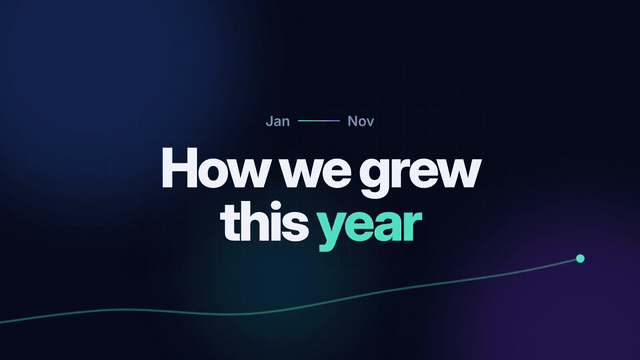
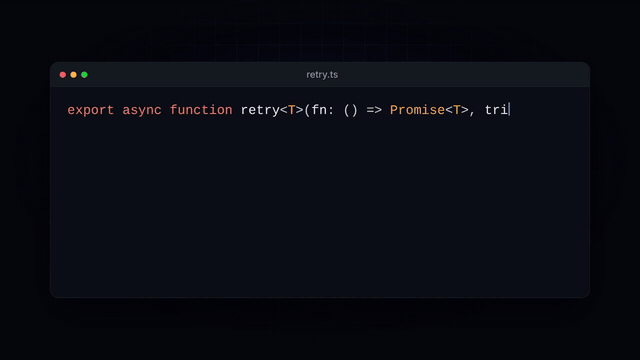

# givemotion: make videos with AI, free and open source

**Ask your AI for a video. Get an MP4.** givemotion is a free, open-source (MIT) video engine made for AI
coding agents like Claude Code, Cursor and Codex. Your agent writes the video, checks it, looks at it, fixes
it and renders it. No license fees, no seats, no per-render costs, and you can fork it and make it your own.

Website: [givemotion.org](https://givemotion.org). (Formerly called motionwright.)

If you are looking for a **free, open-source way to make videos with code**, to **make videos with Claude Code**, or an
**AI motion graphics tool you can run in your own project**, this is it.

<p>
  
  
</p>
<p>
  
</p>

*All three were made by a Claude agent from a one-paragraph brief, using only this project's docs.
They are in [`examples/`](examples).*

---

## Try it in 1 minute

In your project folder:

```bash
npx givemotion init my-video
```

This creates a starter video and installs the instructions your agent needs. Then just ask your agent:

> "Make a 20-second launch video for our app. Use our logo and colors, and put music under it."

The agent writes the video, runs the checks, looks at the frames, fixes what is wrong, and renders
`out/video.mp4`. You can watch and scrub it live with `npx givemotion dev my-video`.

Already have a project? `npx givemotion skill` adds just the agent instructions: a skill pack (a short
`SKILL.md` plus topic files the agent reads when it needs them) in `.claude/skills/givemotion/` for Claude Code and
`.agents/skills/givemotion/` for Codex, and a section in `AGENTS.md` for Cursor and other agents. Run it again after
updating givemotion; `npx givemotion doctor` tells you when the installed pack is older than the engine.

Other ways to install the skill:

- Claude Code plugin: `/plugin marketplace add leonardogrig/givemotion`, then `/plugin install givemotion@givemotion`
- Skills CLI (Claude Code, Codex, Cursor and more): `npx skills add leonardogrig/givemotion`

**You need:** Node.js 20+ and ffmpeg. Chrome is downloaded for you (`npx givemotion install`).

## What you can make

- Product launch videos and app promos (with a cursor that really clicks the right button)
- Explainers with a camera that moves over a map, a diagram or a whole UI
- Hand-drawn whiteboard (Excalidraw-style) explainers: sketchy shapes and arrows that draw themselves on, handwriting
- Animated charts and data stories, from your own JSON data
- Vertical shorts for TikTok, Reels and YouTube Shorts, with word-by-word captions
- Code explainers for developer channels
- Logo stings, title cards, lower thirds, end cards
- Many personalized videos from one template (a different name, number or logo in each)
- Transparent overlays to drop into Premiere, DaVinci Resolve or Final Cut

## Why it works so well with AI

Most video tools were made for people. AI agents work differently, so we built this one around how they
actually behave, and we tested it with real agents instead of guessing.

**1. It uses what AI already knows best: web pages.**
A video is one HTML file with normal CSS and JavaScript. Models have seen billions of web pages, so they
write them well. We tested this: 12 Claude agents made the same 4 videos in plain HTML, in HTML with ready-made
blocks, and in React. Blind AI judges ranked **plain HTML first in 6 of 8 cases** (React scored a little lower;
details in [the experiment](docs/experiments/2026-10-format-test.md)). React still works if you want it.

**2. The agent can check its own work.** An agent cannot watch a video, so the engine does it for them:
- `check` finds text that is cut off, off screen, covered, overlapping, too small or hard to read, lines running
  through labels, two scenes' text smudged together in a transition, broken files and script errors, and says how
  to fix each one. It knows the difference between text that is *moving* past the edge and text that is *stuck* there.
- It also flags pacing: long stretches where nothing happens, a dead end card, an empty opening, or a camera move
  that only arrives after its scene has started to leave.
- It prints a "motion strip", a one-line picture of the video's rhythm.
- `snapshot` makes one image with the key moments of every scene, so the agent can *look* at its video.

**3. It is built from what agents struggled with.** We give fresh agents only the docs and a real brief, read
their notes on what got in their way, and fix the engine, not just the instructions. In the latest full round,
18 agents made 9 kinds of video (promo, explainer, data story, UI demo, whiteboard, code explainer, logo sting,
year recap, vertical short); blind AI judges gave them 7.1 out of 10 on average, none below 6, and their notes led
to about 20 engine fixes ([all rounds and what changed](docs/experiments/)).

**4. Motion design, not slides.** The engine has the tools that make video feel like real animation:
a camera that follows and frames things, motion along paths, shape morphs, shared elements that fly from one
scene into the next, more than 25 scene transitions, kinetic type, particle bursts, live data charts the camera can
ride, hand-drawn sketch shapes and arrows that draw themselves on, labels that stay attached to their shapes, and
cuts and pulses that land on the music's beats.

**5. Natural motion by default.** Things move like real objects without the agent asking for it: entrances
spring in and settle, diagonal moves travel on a slight arc, exits accelerate away, and the camera moves like an
operator (back-to-back shots flow into one move, `follow` trails its target and settles, backgrounds drift for
depth). `<html data-motion="classic">` brings back plain curves when you need them.

**6. The know-how of a motion designer, in the agent's docs.** The skill pack has a short core plus files the
agent reads only when it needs them: 15 technique recipes (kinetic type, camera moves, scene transitions, logo
reveals, charts, UI demos, hand-drawn...), each checked by rendering it; 8 ready-made looks (palette, fonts,
background, motion personality); and guides for 9 kinds of video. Six fonts are built in (Inter, JetBrains Mono,
Playfair Display, Space Grotesk, Bebas Neue, Caveat), so a video looks the same on every machine.

**7. Same input, same video, every time.** Rendering is exact and repeatable, so an agent can change one
thing without surprises elsewhere.

## How it compares

Three tools turn code into video: **givemotion**, **HyperFrames** (by HeyGen) and **Remotion**. All three
render in Chrome and encode with ffmpeg. Here is where they differ, so you can pick the right one. Checked in October
2026; tell us if something changed.

| | givemotion | HyperFrames | Remotion |
|---|---|---|---|
| License | MIT, free for everyone | Apache 2.0, free for everyone | Free for individuals, non-profits and companies of up to 3 people; bigger companies need a paid license¹ |
| You write | HTML, CSS, JavaScript (React optional) | HTML, CSS, JavaScript | React |

¹ From Remotion's [`LICENSE.md`](https://github.com/remotion-dev/remotion/blob/main/LICENSE.md); prices are on its website.

**Tested with AI agents (October 2026).** Fresh Claude Opus agents made the same 9 briefs (promo, explainer,
data story, UI demo, whiteboard, code explainer, logo sting, year recap, vertical short), twice each, once with
givemotion and once with Remotion 4.0.538. 27 blind AI judges scored the 36 videos, 4 at a time per brief.

| | givemotion | Remotion |
|---|---|---|
| Judges' overall score (1-10) | **7.2** | 6.8 |
| Briefs won | 5 of 9 | 4 of 9 |
| Render time for all 18 videos (4 CPUs, no GPU) | **547 s** | 1102 s |
| Same animation in both tools, default settings | **14.6 s** | 27.1 s |
| Code the agent wrote per video (median) | **240 lines** | 617 lines |

givemotion rendered every video faster (about 2× overall) and needed far less code, because the camera, beat
detection and hand-drawn shapes are built in (the Remotion agents wrote their own). The quality edge is small
and mostly fewer visible mistakes; Remotion won the year recap, explainer, whiteboard and promo briefs. These are AI
judges looking at frames, on one machine. givemotion contains no code from
Remotion, and the test used Remotion only as a user does. We are not affiliated with Remotion.

The next table compares givemotion with **HyperFrames** in more detail, from each project's own docs and
command-line help.

| | givemotion | HyperFrames |
|---|---|---|
| Made by | Independent open-source project | HeyGen |
| License and price | MIT. Free for everyone, including companies | Apache 2.0. Free for everyone, including companies |
| You write | HTML, CSS, JavaScript (React optional) | HTML, CSS, JavaScript |
| Instructions for AI agents | Yes, one command (`npx givemotion skill`) | Yes, many skills (Claude Code, Codex, Cursor, Gemini CLI and more) |
| Agent checks its own video | Yes: cut-off, covered, overlapping, tiny and low-contrast text, lines through labels, smudged transitions, broken files, script errors with line numbers, pacing (long still parts, dead end cards, empty opening, late camera moves) | Yes: lint, script errors, layout overflow, motion, WCAG contrast |
| Agent sees key frames | Yes: one picture with the key moments of every scene, or a frame-by-frame strip of one move; `analyze` reports the cuts, pacing, camera and colors of any video and compares it with a reference | Yes: key frames, a review set around every cut, side by side with a reference video |
| Music beats | Tempo, beats, bar starts, big hits | Beats, hits, loudness, silence |
| Output | MP4, WebM, MOV (ProRes 4444 with transparency), GIF, PNG frames, MP3 | MP4, WebM, MOV (ProRes 4444), GIF, PNG frames, HLS, HDR |
| Rendering in the cloud | No (renders wherever Node runs) | AWS Lambda, Google Cloud Run, HeyGen's cloud |
| Visual editor | Browser preview (scrub, frame-step, sound) | Desktop app (macOS, Linux) and browser preview |
| Built-in AI extras | None | Text to speech, transcription, background removal |
| Usage data sent home | None | Anonymous usage data, on by default (can be turned off) |

HyperFrames facts are from its [docs](https://hyperframes.heygen.com) and the help of `hyperframes` 0.8.191 on npm.

**Speed.** In our one test (the same GSAP animation, 10 s at 1080p, on a small cloud machine with 2 CPUs and no
GPU), givemotion rendered it in 22.2 s and HyperFrames in 36.8 to 40.0 s at the same quality. That is one
animation on one machine; HyperFrames has a GPU capture path we could not test there. The script is in
[`benchmarks/vs-hyperframes`](benchmarks/vs-hyperframes) so you can run it yourself.

**Pick givemotion if** you want something small and fully free to fork (MIT, no npm dependencies, sends no data),
checks that also look at pacing, and motion-design tools built in (a camera that follows and frames things, path
travel, morph transitions, beat-synced cuts). **Its weak points today:** it is new, with a small community, no
cloud rendering, no desktop editor, no voice or transcription tools, and pages with many full-screen effects
render slowly on machines without a GPU.

**Pick HyperFrames if** you want the biggest feature set right now: cloud rendering, a desktop app, voice and
transcription tools, HDR and HLS output, and a large community backed by HeyGen.

HyperFrames and the other code-to-video tools are great projects and inspired parts of this one. givemotion shares the idea, not the code.

## Make your own version (fork it)

MIT means you can take this and build on it, even sell what you make with it. One idea we like: **a fork
focused on one style.** For example a "whiteboard" edition, a "tech launch" edition, or your company's brand
edition:

1. Fork the repo.
2. Add blocks in [`blocks/`](blocks) for your style: your title cards, your charts, your transitions, your colors.
3. Add your look to the agent instructions ([`skills/givemotion/references/styles.md`](skills/givemotion/references/styles.md)
   holds the built-in ones): which blocks to use, which colors, which fonts, what to avoid.

Agents then make videos in that style much faster and more consistently, because they start from pieces that
already look right instead of inventing everything each time.

## Questions people ask

**Is there a free, open-source way to turn code into video?** Yes. givemotion (MIT) and HyperFrames (Apache 2.0) are both free for any
use, including big companies. See [How it compares](#how-it-compares).

**Is it a free alternative to Remotion?** It does the same job (code in, video out) with HTML instead of React, under
MIT for everyone. In our test it rendered about 2× faster; see [How it compares](#how-it-compares).

**Can Claude Code make videos?** Yes. Run `npx givemotion init` (or `npx givemotion skill` in an existing
project) and ask Claude Code for a video. It also works with Cursor, Codex and other agents that read an
`AGENTS.md` file.

**Do I need to know how to code?** No. You talk to your agent; the agent writes the code. If you do know HTML
and CSS, you can open the file and change anything.

**Can I use it for client work or commercially?** Yes, for free. MIT license.

**Can I put my own music, voice-over, logos and videos in?** Yes. Audio tracks with volume curves and ducking
under a voice, video clips, images, fonts, and captions from a word-timed file or an `.srt`.

**How fast is it?** Fast on a normal computer, faster with more cores and a GPU. It renders with several browsers
at once and skips frames that did not change. See [Performance](#performance).

---

## For developers

### A composition

```html
<!doctype html>
<html data-width="1920" data-height="1080" data-fps="30">
<head>
<style>
  body { background: #0b0d12; color: #fff; font-family: Inter, system-ui, sans-serif; }
  .scene { display: grid; place-items: center; }
  h1 { font-size: 120px; margin: 0; }
</style>
</head>
<body>
  <main data-sequence data-transition="fade 0.6">
    <section class="scene" data-duration="3" data-camera="push 1.1">
      <h1 data-enter="rise">Hello</h1>
    </section>
    <section class="scene" data-duration="4">
      <h1 data-split="words" data-enter="fade-up 0.6" data-stagger="0.08">Any HTML. Any CSS.</h1>
      <audio src="music.mp3" data-volume="0.4" data-fade-out="1"></audio>
    </section>
  </main>
</body>
</html>
```

No imports and no build step: the runtime is added for you. Everything that moves on a web page is played
on a virtual clock and captured frame by frame: CSS animations, transitions, the Web Animations API, timers,
`requestAnimationFrame`, canvas, WebGL, GSAP, Lottie. There is also a built-in GSAP-style timeline
(`gm.timeline()`), a camera (`gm.camera()`), path travel, shape morphs, `gm.fly()` (move an element in from where
another one is), live line charts (`gm.chart.line()`), hand-drawn shapes (`data-sketch`), labels pinned to shapes
(`data-anchor`), particle bursts, and music analysis (`gm.audio()`, `gm.beat(n)`, `data-pulse`, cuts written in beats).

The full reference is the skill pack written for agents (and good for humans too):
[`skills/givemotion/SKILL.md`](skills/givemotion/SKILL.md) and the topic files in
[`skills/givemotion/references/`](skills/givemotion/references).

### Commands

| Command | What it does |
|---|---|
| `init [dir]` | New project: starter video, agent instructions, AGENTS.md |
| `skill` | Add the agent instructions to an existing project |
| `dev [file]` | Live preview with a timeline, scrubbing, frame stepping and sound |
| `render [file] -o out.mp4` | Render to `.mp4` `.webm` `.mov` `.gif`, a folder of PNGs, or just the soundtrack (`.mp3`) |
| `still [file] -t 2.5 -o f.png` | One exact frame |
| `check [file]` | Problems with fixes, plus the motion strip |
| `snapshot [file]` | Key moments of every scene in one image |
| `inspect [file]` | Timeline as JSON; `--at 3.2 --el "#logo"` says where anything is at any moment |
| `audio <file>` | Tempo, beats, bar starts and big hits of a song |
| `captions <file>` | The caption pages a word-timed `.json` or `.srt` will show, so you can pick how many words per page |
| `analyze <video.mp4>` | Report on any video (a reference, or your render): shots and cuts, transitions, camera, pacing, colors, cuts on the beat, contact sheets. `--compare ref.mp4` lists how yours differs |
| `bundle [file] -o dir` | Standalone page + `<gm-player>` to embed the video in any site |
| `blocks` / `add <name>` | Ready-made blocks you can copy and edit |
| `install` / `doctor` / `bench` | Get Chrome, check your setup, measure speed (and what makes a page slow to draw) |

Render options: `--quality draft|standard|high|max`, `--fps`, `--scale 2` (4K from a 1080p layout),
`--frames 2s-5s`, `--transparent`, `--motion-blur 8|auto`, `--codec h265|av1`, `--hardware`, `--workers`,
`--muted`, `--data file.json`, `--props '{…}'`. Every command takes `--json`.

Rendering again after a change only redoes the parts of the video that changed (edit one scene → only its 1-2 s parts
are rendered; in one long scene, an edit to something that appears at 40 s keeps the first 40 s), and the result is
byte-identical to a full render. `--redo 4s-7s` forces a range, `--no-cache` turns it off.

### Programmatic API

```js
import { render, check, snapshot, still, inspect } from 'givemotion';

await render('video.html', { output: 'out/video.mp4', quality: 'high', data: { name: 'Ada' } });
const report = await check('video.html');           // { ok, errors, warnings, issues: [...] }
const { sheet } = await snapshot('video.html');     // path to the contact sheet
```

### Blocks

Plain-HTML building blocks you copy into your project and edit freely (`npx givemotion add <name>`):
title-card, lower-third, captions, code-window, bar-chart, line-chart, stat, checklist, steps, browser-window,
phone, cursor, callout, compare, quote, word-pop, logo-reveal, end-card, gradient-bg, grid-bg, lottie.

### Performance

Measured on a small cloud machine (2 CPUs, no GPU), 1080p at 30 fps, 300 frames:

| | Time |
|---|---|
| Simple approach: one browser, PNG screenshots, no frame reuse | 32.7 s |
| givemotion, 1 worker | 15.0 s |
| givemotion, auto workers | 13.3 s |

The same GSAP animation in givemotion and HyperFrames on that machine: 22.2 s vs 36.8 to 40.0 s
([method and script](benchmarks/vs-hyperframes)).

On a 4-CPU cloud machine without a GPU (October 2026), that same test page renders in 14.6 s (22.6 s with one
worker), and the 18 videos agents made in our latest test round (5 to 31 s long, 1080p) rendered at 18.8 frames per second on
average. Pages with many full-screen effects are slower on machines
without a GPU. Run `npx givemotion bench` on your own computer.

Where the speed comes from: Chrome's frame-by-frame capture (`beginFrame`, on Linux and Windows), several
browsers rendering parts of the video at once, reusing frames that did not change, and encoding while capturing.

**On a Mac** it uses the GPU for drawing, and the Mac's hardware video encoder (VideoToolbox) for MP4 by default,
once a quick one-time check shows the encoder gives the same bytes every time (so renders stay exact and re-renders
can reuse parts). `npx givemotion doctor` says which encoder you get; `--no-hardware` turns it off. Frame capture
on macOS uses screenshots, because Chrome's frame-by-frame capture is not available there.

### How it works

```
HTML ──► local server (adds the runtime, expands blocks and {{data}}, serves video frames)
           │
           ▼
 headless Chrome × N  ── runtime: virtual clock, seeks every animation to the exact time
           │  capture each frame
           ▼
      ffmpeg × N (segments) ──► join + audio mix ──► out.mp4
```

### Requirements

- Node.js 20+
- ffmpeg on your PATH (`brew install ffmpeg`, `sudo apt install ffmpeg`, `winget install ffmpeg`)
- Chrome: `npx givemotion install` downloads it, or it finds the one you have

givemotion itself has **zero required npm dependencies**.

### Status

givemotion is young (0.x). Compositions written today should keep working, but options and APIs may still
change between minor versions; changes are listed in the release notes.

## Contributing and security

Pull requests and issues are welcome: see [CONTRIBUTING.md](CONTRIBUTING.md) (and [AGENTS.md](AGENTS.md) for the
code layout). A composition is code that runs in Chrome; if you render compositions or data from people you don't
trust, read [SECURITY.md](SECURITY.md) first. Report security problems privately, as described there.

## License

MIT. Use it, change it, fork it, sell what you make with it. Chrome and ffmpeg are installed separately under
their own licenses. The example music and images were made for this project and are MIT too. The bundled fonts
(Inter, JetBrains Mono, Playfair Display, Space Grotesk, Bebas Neue, Caveat) are under the SIL Open Font License
(license files in `src/runtime/fonts/`). Everything third-party is listed in
[THIRD_PARTY_NOTICES.md](THIRD_PARTY_NOTICES.md).

This project was written from scratch. It shares the idea of "turn a web page into a video" with tools like
Remotion and HyperFrames, but no code from them. Remotion and HyperFrames are trademarks of their owners.
