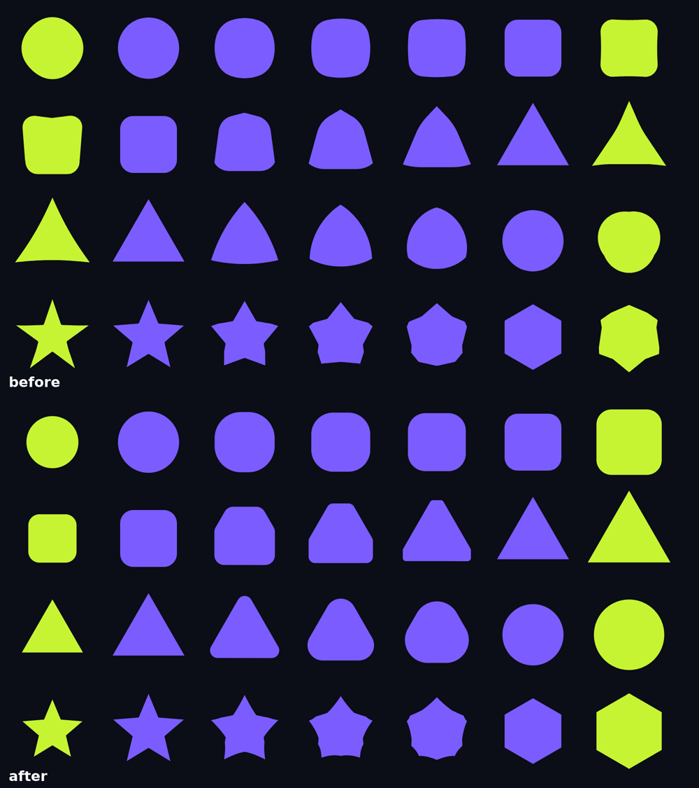
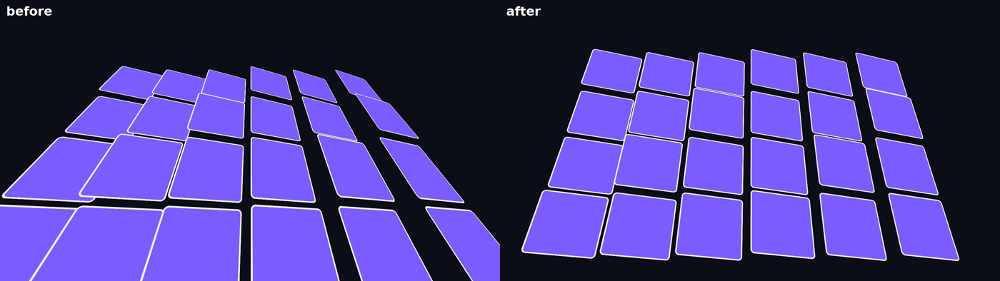
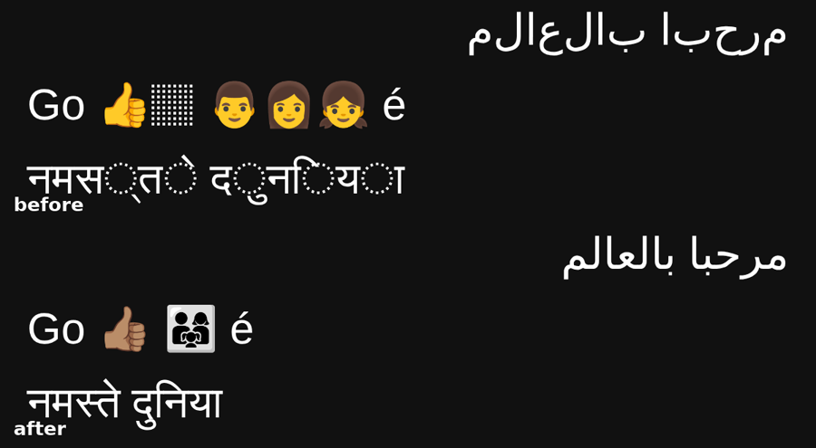

# Agent rounds on random briefs (November 2026)

What we wanted to know: on briefs nobody tuned for, how good are the videos AI agents make with givemotion, where do
they lose points, and which changes move the score.

## Method

- Each brief is drawn at random (genre, subject, three motion techniques, format, length) and written by a fresh AI
  session that does not know which tool will make it.
- A fresh Claude Opus 5.5 session (effort high) makes the video with givemotion, using only givemotion's docs. As a
  reference, the same brief is also made by fresh sessions with two other established code-to-video tools, each used
  the way a normal user would use it, with only its own public docs. The reference tools are not named here, and no
  frames made with them are published; they are a yardstick, not a subject.
- Six blind AI judges per brief see contact sheets, motion strips and key frames of the videos under letters, in every
  order once, and score brief fit, spec, motion, craft and errors (1-10).
- Raw judge notes, prompts and process numbers are kept outside this repository.

## Results so far (7 random briefs, rounds 2-5)

| | givemotion | reference tools (each) |
|---|---|---|
| Judges' overall, mean of 7 briefs | 6.76 | 7.12 and 7.00 |
| Briefs where givemotion was first | 2 of 7 | |
| Errors score (visible mistakes), mean | 6.45 | 7.00 and 6.83 |
| Maker cost and time | lowest on every brief | |
| Render time | fastest on every brief (about half in round 5) | |

givemotion was the cheapest and fastest every time, and not ahead on quality. Its weakest category was visible mistakes.

## What the judges flagged in givemotion's videos

- Stray or leftover elements: a marker parked inside a hero number, labels still on screen in the next scene, a part
  poking into the frame before its beat.
- Hand-overs: a new word landing on the previous one while it was still dissolving.
- Timing: beats running a second or more behind the brief.
- Rolling numbers as a jumble of half digits (hand-built counters); motion smear that turned small fast objects and
  type into blurs.
- A required item from the brief missing.

## What changed in the engine and the skill

- `data-count-roll`: a readable odometer (one wheel per digit, clipped to one line, carry roll, ticking when too fast).
- Motion blur keeps shapes: the smear on text stops at 0.3 of its font size, on anything under 15% of the frame at 0.15
  of its smaller side.
- `check`: `text-carried-over`, `stray-mark`, `no-expect`, `data-expect` timing promises, `upside-down-text`,
  `orphan-word`, `mirrored-text`.
- Shape morphs, the 3D camera and grapheme-safe splitting (before and after, givemotion only):
  
  
  

## The lesson

Fixing the last video's specific mistakes did not raise the next round's score: every random brief fails in its own
way. The measurable difference was process. givemotion's makers used about half the tool calls and looked at about half
as many of their own frames as the reference makers, in the same time, and lost most points to mistakes a second look
catches. So the next change is general, not per-genre:

- `givemotion review`: the video as a viewer sees it (overview, the frames people read, motion strips at the busy
  moments, the check report and a scoring rubric), fast enough to run twice.
- The skill's loop: direct first (research the genre, write the look, type, motion language and shot list), style
  frames before motion, then review twice, with a fresh sub-agent as critic when possible
  (`skills/givemotion/references/direction.md`).

## Round 6: the review loop

Three new random briefs (a deep-sea product teaser in vertical format, a jazz-festival poem in a sketch look with a UI
and a route map, a recycling-program manifesto with a map). Every maker, givemotion and reference, had every tool on:
any shell command, web search, sub-agents. givemotion's makers followed the new loop: they ran `review` about 18-20
times per video, called a fresh critic sub-agent twice, and looked at 24-29 of their own frames (the reference makers
8-22). They took 18-28 minutes, in line with the reference makers (16-30). No maker used web search.

| | givemotion | reference tools (each) |
|---|---|---|
| Judges' overall, mean of 3 briefs | **7.11** (6.33, 7.33, 7.67) | 7.22 and 6.83 |
| Judges ranking it first | 5 of 18 | 13 of 36 |

Up from 6.76 over the previous seven briefs, and within 0.1 of the best reference tool. Its lowest brief (6.33) lost
almost all of its points to one engine default: the judges read the automatic motion blur as ghosting and doubled text
("the counter overlapping itself", "cards breaking up"). That was the fourth brief where blur cost points and none
where it earned any, so motion blur is now off by default (`--motion-blur auto` turns it on).
