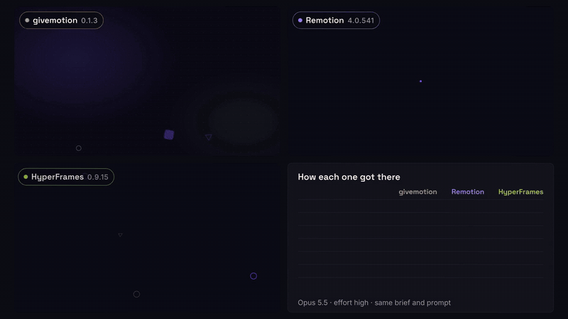

# KINETIC: givemotion, Remotion and HyperFrames on one motion-design brief (2026-11-05)

A 20-second motion reel made three times by Claude Opus 5.5 at effort high: once with givemotion, once with Remotion,
once with HyperFrames. Each maker was a fresh, headless Claude Code session in its own folder, with the same prompt and
only its own tool's official agent docs. Six blind Opus judges then scored the three videos. One video plays all
three side by side with their labels and process numbers, then each one large with its scores, and ends on the
scoreboard.

The full comparison video (100 s, 1080p) is `compare/out/compare.mp4` in the round folder. Its builder is
[data/2026-11-kinetic/compare-build.mjs](data/2026-11-kinetic/compare-build.mjs).

One brief and one run per tool is a showcase, not a benchmark: a second run of the same maker would score
differently. The earlier three-tool round on another brief came out the other way round between the top two (Remotion
7.7, givemotion 7.5: [2026-11-tools-showcase.md](2026-11-tools-showcase.md)).

## Results

| | givemotion | Remotion | HyperFrames |
|---|---|---|---|
| **Judges' overall** (1-10, mean of 6) | **7.8** | 7.2 | 6.2 |
| Average rank (of 3) | **1.17** | 1.83 | 3.00 |
| Judges' #1 picks | **5 of 6** | 1 of 6 | 0 of 6 |
| Tokens (input + cache + output) | 9.35M | **7.26M** | 7.45M |
| Output tokens (thinking included) | **93k** (62k) | 96k (59k) | 107k (67k) |
| Cost at API list prices | $5.45 | **$4.85** | $5.37 |
| Minutes to a finished video | 59.0 | **23.9** | **23.9** |
| ...of which waiting on the tool's own commands | 37.6 | 7.4 | **5.7** |
| Tool calls | 59 | 61 | **57** |
| Frame images it looked at | 13 | 12 | **19** |
| Code written (non-empty lines) | **347** (1 file) | 1252 (15 files) | 763 (2 files) |
| Sandbox refusals | **1** | 3 | 4 |
| Render, 20 s at 1080p, each tool's own command | 925 s (**331 s** after the fix below) | 176 s | **142 s** |

Judges' scores per dimension (mean of 6, 1-10):

| | brief | spec | motion | craft | errors | overall |
|---|---|---|---|---|---|---|
| givemotion | **8.7** | **8.8** | **8.0** | **8.0** | **7.5** | **7.8** |
| Remotion | 8.2 | **8.8** | 7.5 | 7.2 | 6.7 | 7.2 |
| HyperFrames | 7.2 | 8.7 | 6.7 | 6.8 | 5.8 | 6.2 |

How each judge ranked them (each judge saw a different A/B/C order; all six orders were used once):

| judge | order shown (A, B, C) | 1st | 2nd | 3rd | overall scores (gm / Rem / HF) |
|---|---|---|---|---|---|
| 1 | gm, Rem, HF | givemotion | Remotion | HyperFrames | 8 / 7 / 6 |
| 2 | gm, HF, Rem | givemotion | Remotion | HyperFrames | 8 / 7 / 6 |
| 3 | Rem, gm, HF | givemotion | Remotion | HyperFrames | 8 / 7 / 6 |
| 4 | Rem, HF, gm | givemotion | Remotion | HyperFrames | 8 / 7 / 6 |
| 5 | HF, gm, Rem | givemotion | Remotion | HyperFrames | 8 / 7 / 6 |
| 6 | HF, Rem, gm | Remotion | givemotion | HyperFrames | 7 / 8 / 7 |

All three delivered exactly 20.0 s at 1920x1080 and 30 fps with H.264. All three used only the palette, the two
fonts and the exact copy, and hit all five beats in order. None needed a second try.

**In short:** givemotion made the film the judges preferred (first for 5 of 6, 7.8). Remotion came second (7.2) with
the best sense of one continuous world, and HyperFrames third (6.2) with the most visible errors. On process,
Remotion's maker was the cheapest, HyperFrames rendered fastest, and givemotion's maker wrote the least code by far but
took the longest. It spent 38 of its 59 minutes waiting on givemotion's own `check`, `snapshot` and `render`. Most of
that wait came from an engine choice this test exposed and that is now fixed (below).

## The brief

"KINETIC", written for this round and tool-neutral: it says "video", never HTML or React. It asks for many kinds of
motion in 20 s, in one continuous piece with no hard cuts. The full brief is
[data/2026-11-kinetic/brief.md](data/2026-11-kinetic/brief.md).

1. **0-3 s, the spark.** A violet dot pops in, pulses like a heartbeat and morphs (true outline morphs) into a rounded
   square, a triangle and back into a circle, turning and settling elastically each time.
2. **3-7 s, the path.** The circle shoots along a curve that draws itself behind it as a lime line, with a follow
   camera, parallax at three depths and a motion trail.
3. **7-11 s, the words.** `SHAPE`, `MOVE`, `FLOW` (Space Grotesk bold, ≥ 220 px), each with a different text
   technique, handing over through motion, each readable for ≥ 0.8 s.
4. **11-15 s, the system.** The camera pulls back and tilts: the words sat on one card of a 6 x 4 grid in 3D. A wave
   ripples from the centre, and three counters count up: `60 FPS`, `120 SHAPES`, `1 TIMELINE`.
5. **15-20 s, the title.** One card flies forward and grows into the background of the end title (a shared-element
   transition). `KINETIC` lands with the three shapes from beat 1 taking part, with `every frame, on purpose` under it,
   held ≥ 2 s.

The palette was near-black, cream, violet `#7B5CFF` and lime `#C6F432`, with no other hues. Everything had to be drawn
by the maker: no images, emoji, icons or library clip art.

## How it was run

- **Makers.** Three `claude -p` sessions (headless Claude Code, model `claude-opus-5-5`, `--effort high`), started at
  the same time on one 4-core Linux machine without a GPU. Each ran in its own folder outside this repository, so no
  project `CLAUDE.md` loaded. User settings and MCP servers were off. Web fetch, web search and subagents were disabled.
  Every maker had the same built-in Claude Code skills, none of them about video.
- **What each maker got.** The brief, the fonts as local files (Space Grotesk and Inter, OFL), and its own tool's agent
  docs at the latest release on 5 November 2026:
  - givemotion 0.1.3 (main at `26c811f`), installed from `npm pack` into the folder, with its skill pack
    (`SKILL.md` and `references/`) copied to `skills/givemotion/`.
  - Remotion 4.0.541: a project from `npx create-video@latest --yes --blank --no-tailwind`, plus Remotion's official
    agent skills (`remotion-dev/skills` at `a2824c6`, version 4.0.541) in `skills/`.
  - HyperFrames 0.9.15: a project from `hyperframes init --example blank` (with its own `CLAUDE.md`), plus the core
    skills its CLI installs (hyperframes, hyperframes-cli, hyperframes-registry, media-use) in `skills/`. `init`
    installs those skills into the user's global skill folder, where every session (including the other two makers
    and the judges) would have seen them. They were moved into the HyperFrames folder before any session started.
- **Prompt.** The same for all three
  ([prompt-common.txt](data/2026-11-kinetic/prompt-common.txt), plus a few lines per tool:
  [givemotion](data/2026-11-kinetic/notes-givemotion.txt), [Remotion](data/2026-11-kinetic/notes-remotion.txt),
  [HyperFrames](data/2026-11-kinetic/notes-hyperframes.txt)). It says: read the brief and your tool's docs, work the
  way a normal user would, look at your own frames and fix what you see, no limit on calls or time, there is no person
  to ask, render to `out/video.mp4`, and end with a short report. The three reports are in
  [data/2026-11-kinetic/](data/2026-11-kinetic/) (`report-*.md`).
- **The sandbox and the network.** File edits were accepted inside the maker's folder only, and shell commands were
  limited to an allowlist (`npx`, `npm`, `node`, `ffmpeg`, `python3` and common file commands;
  [run-maker.sh](data/2026-11-kinetic/run-maker.sh)). Everything else was refused and logged. The refusals were
  harmless chained commands the permission parser would not split (a `for` loop, heredocs with JSON, `cmd || cmd`).
  givemotion had 1, Remotion 3 and HyperFrames 4, and each maker reworded the command and carried on. Afterwards
  every path in every tool call was checked: no maker read or wrote outside its own folder and its own Claude scratch
  folder. The machine's network blocks some hosts, which hit the two other tools and not givemotion (whose docs and
  runtime are all local):
  - Remotion: `remotion.media` (its Chrome download) and `remotion.dev` (its online docs) are unreachable. Chrome
    Headless Shell was preinstalled and set in `remotion.config.ts`, and the prompt said the online docs were out of
    reach. Its skills link to online pages for some topics, which its maker could not read.
  - HyperFrames: `cdn.jsdelivr.net` is unreachable, and the blank template loads GSAP from it. GSAP 3.15.0 with all
    its plugins (from npm) was put in `vendor/gsap/`, the template's script tag was pointed there, and the prompt said
    so. Its registry (GitHub raw) was reachable.
- **Judges.** Six fresh `claude -p` sessions (Opus 5.5, effort high) that could only read files in their own folder.
  Each had the brief and, per video, two contact sheets (a frame every 0.5 s), one motion strip per beat (1 s at
  10 fps) and four larger key frames: 33 images per judge. Every judge opened all of them. The three videos were A, B
  and C in a different order for each judge (all six orders once). Judges scored brief, spec, motion, craft, errors
  and overall (1-10), ranked the three and wrote notes with time stamps
  ([judge-prompt.txt](data/2026-11-kinetic/judge-prompt.txt); raw results in
  [judges/scores.json](data/2026-11-kinetic/judges/scores.json)). Judging cost $3.97 in total.
- **Render time.** Each final video was rendered again, one at a time on the idle machine, with the exact command its
  maker reported: `npx --yes hyperframes@0.9.15 render --quality delivery --fps 30`,
  `npx remotion render Kinetic --codec=h264 --pixel-format=yuv420p --bundle-cache=false`, and
  `npx givemotion render video.html --no-cache`. HyperFrames and Remotion each had one untimed warm-up first, which
  agreed with the timed pass within 10%. givemotion was not warmed up, because a warm-up takes 15 minutes on this page.
  Each tool rendered its own composition, so this measures the maker's experience on this brief, not the engines on
  identical work.
- **Tokens, cost and time** come from each session's own result record (`modelUsage`, at API list prices) and from wall
  clock start and end times. "Waiting on the tool" adds up the time between each tool call and its result.

## The three videos

All three makers read the brief the same way underneath. Each built one 3D world with one camera, wrote its own
morphs, drew the line with a stroke dash, used the line as the underline and wipe for the words, made `FLOW` out of
`MOVE`'s scattered letters, and had the three shapes collide into `KINETIC`. givemotion's maker did it with
`gm.timeline` and the engine's camera shots in one 347-line HTML file. Remotion's maker computed every frame in React
from `useCurrentFrame` across 15 files with its own small timeline library. HyperFrames' maker built a GSAP timeline in
one big sub-composition.

**givemotion (7.8, first for 5 judges).** The judges' words were "the most complete and polished". It opens with a
heartbeat ring, a glow and squash before the launch. The word card glides in under the line while it is still
drawing. Each word has its own technique: letters rising out of a burst, a lime-bar wipe from `SHAPE` to `MOVE`, then
a scatter into `FLOW`. The grid is the richest of the three, with drawn shapes on the cards, lime counters and a
visible staggered lift. The `FLOW` card itself flies forward and turns violet as the end card, so the shared element is
literal. The weak spots: the square and triangle look lumpy mid-morph around 2.0 s. The path beat is sparse for some
judges (4.5-5.4 s). For one beat at 17.0 s, the burst ring and shapes pile onto `KINETIC` before it settles. Cream on
violet in the title is only medium contrast. Judge 6 also saw the card flip with a mirrored `FLOW` at 15.0 s.

**Remotion (7.2, first for 1 judge).** It has the best sense of one world: the card grid is already visible under the
path in beat 2, with dense parallax, and the line writes `SHAPE` onto its card, so the pull-back at 11.5 s really
shows the same card. The violet card's flight to fill the frame was called "textbook" by two judges. The weak spots:
the triangle is wobbly at 2.0 s. `SHAPE` and `MOVE` sit on top of each other with the line striking through both at
8.4-8.5 s (all six judges noted it). The counters start late and are faint, and the grid wave is timid. The end title
is plain (flat violet, low-contrast tagline). Its maker also noted that its video came out as `yuvj420p`
(full-range), although it asked for `yuv420p`.

**HyperFrames (6.2, last for all 6 judges).** It has the crispest morphs (a clean triangle at 2.0 s), the clearest
domed 3D wave, and the punchiest end frame: near-black `KINETIC` on lime, which every judge called the most legible
title. But it had the most errors. At 6.5 s the frame is almost empty, with only the dot at the left edge. The slice
hand-over from `SHAPE` to `MOVE` at 8.7-8.8 s reads as broken glyph fragments. At 15.5 s the flying card shows a
circle-masked, clipped `LOW` that every judge read as a glitch. The parallax in beat 2 is tiny specks. Its maker wrote
`SPEC.md` and `REVIEW.md`, as its skill asks, and named the 16.4 s pile-up of letters as its own weakest moment.

## My scores and feedback

I work on givemotion, so read this as one opinion and weigh the blind judges above it. Where I was unsure, I scored
against givemotion.

| | story and continuity | motion | look and craft | errors | process (tokens, time, code) | render speed | overall |
|---|---|---|---|---|---|---|---|
| givemotion | 7.5 | 8 | 8 | 7.5 | 6 | 4 | **7.5** |
| Remotion | 8.5 | 7.5 | 7 | 6.5 | 8.5 | 7 | **7.5** |
| HyperFrames | 6 | 7 | 7 | 5.5 | 8 | 8 | **6.5** |

- **On the film, the judges' order is right.** givemotion's frames are the most finished and its hand-over (the word
  card itself becoming the title) is the most literal. Remotion tells the "one world" story better: its grid is there
  from beat 2, which is what the brief was really asking for. That is the same strength its maker showed in the last
  round. HyperFrames had the best single frame and the most mistakes.
- **On the process, givemotion lost clearly.** Its maker needed 2.5x the wall time of the other two and 1.3x their
  tokens. That was not extra thinking: its output tokens were the lowest of the three. It came from waiting, with each
  `check` taking about 2 minutes, each snapshot 1.5-2.6 minutes and the render 16 minutes, and from the long context
  that waiting keeps re-reading. A user on a slower machine would feel that more than any score difference.
- givemotion's maker also hit two engine problems it had to work around (its report, "What got in the way"): with the
  camera zoomed out, 3D card turns looked about 6x stronger than set, and back-to-back camera shots blended into one
  curve, so a hold drifted 200 px. Neither showed in the final frames, but both cost it iterations.

## What this means for givemotion

Sorted by where the fix belongs (CLAUDE.md, "How to handle feedback"):

- **Engine, fixed in this round: givemotion picked the slow capture path.** This machine (like many CI and container
  images) sets `CHROME_PATH=/usr/bin/google-chrome` for Puppeteer. givemotion honoured it ahead of the
  chrome-headless-shell that was also installed, and a full Chrome has no BeginFrame capture, so every `check`,
  `snapshot` and `render` fell back to screenshots. On 15 frames of the grid scene, screenshot capture took 47 s and the
  headless shell 21 s; motion blur cost nothing either way. Now `--chrome` and `GIVEMOTION_CHROME` still come first,
  then any chrome-headless-shell on the machine (givemotion's own, Puppeteer's or Playwright's), and only then
  `CHROME_PATH` and installed Chromes. The same video now renders in 331 s instead of 925 s (2.8x faster), and the
  frames match the screenshot render (PSNR 65.9 dB average, 53 dB lowest). The skill's output reference says which
  Chrome is used and why (`src/browser.js`, `references/output.md`).
  The e2e test of renders sharing the computer assumed the slow path: its 320x180 page finished before the render could
  grow and give workers back. It now uses a 960x540, 40 s page, and passes with either browser (`test/e2e.test.js`).
- **Engine, fixed in this round: a crash on video frames.** Rendering the comparison video (three `<video>` tiles)
  crashed with `ENOENT … frames/…/0000001.jpg`. The video-frame cache treated a frame as decoded whenever the *next*
  frame's file existed. When an earlier extraction had started later in the video (another worker, or an earlier still
  that asked for a later frame first), the frames before it were never written, and the render read a file that did
  not exist. Now a frame counts as ready only when its own file exists, and a gap is filled by an extraction that stops
  at the next frame already on disk, so no file is rewritten while another reader uses it. There is a new e2e test
  that asks for a later frame first, then the one before it (it fails without the fix) (`src/server.js`,
  `test/e2e.test.js`).
- **Engine, open: heavy 3D pages are slow without a GPU.** Even with the headless shell, givemotion took 331 s against
  176 s for Remotion and 142 s for HyperFrames, on compositions of similar ambition. The grid section of givemotion's
  page draws at about 0.7 fps per worker. Its page has a `blur(120px)` glow and other blurred layers inside a
  `preserve-3d` world with 24 cards, and the earlier speed study found that big filters double the compositing cost.
  `check` and `snapshot` are slow on the same page (about 2 minutes each). Added to `docs/NEXT.md` with this page as
  the repro.
- **Engine, open: the camera and 3D depth.** The maker found that at a zoomed-out camera, rotations inside the world
  read about 6x too strong ("the camera scales the world flat but not in depth"), and that shots placed back to back
  blend into one curve unless `blend: false` is set. Both need a minimal repro before deciding whether this is a bug
  or a docs gap. Added to `docs/NEXT.md`.
- **Skill.** Remotion's edge was again continuity: setting up the next beat's world early (the grid under the path).
  The skill's camera and scene-transition recipes could say it outright: let the next beat's set be visible before
  you arrive in it. The judges' recurring nits (a burst ring covering the title as it lands, cream on violet at medium
  contrast) are general craft that `check` partly covers (`low-contrast`). Not changed in this round.

## Files

- In this repo: [data/2026-11-kinetic/](data/2026-11-kinetic/). It holds the brief, prompts, the maker runner and
  sandbox allowlist, the judge prompt and runner, the pack, stats and score scripts, the render-timing script, the
  comparison-video builder, raw stats and judge results, and the makers' final reports. The scripts expect the round
  folder at `/home/user/tools4` (change `R` at the top to move it).
- Round folder (local, not in git): `/home/user/tools4/`. It has the three makers' folders (sources, renders,
  snapshots), their full transcripts (`harness/*.jsonl`), the judging packs and transcripts, the render-timing renders
  and logs, and `compare/` (`compare/out/compare.mp4`, 100.4 s).
