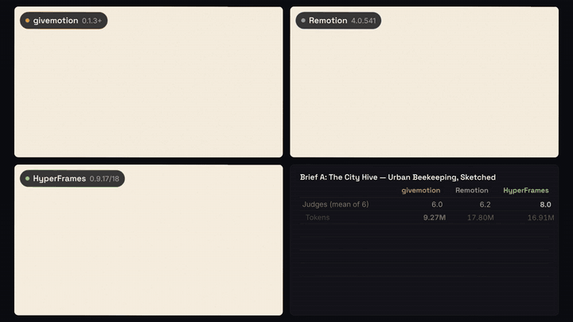
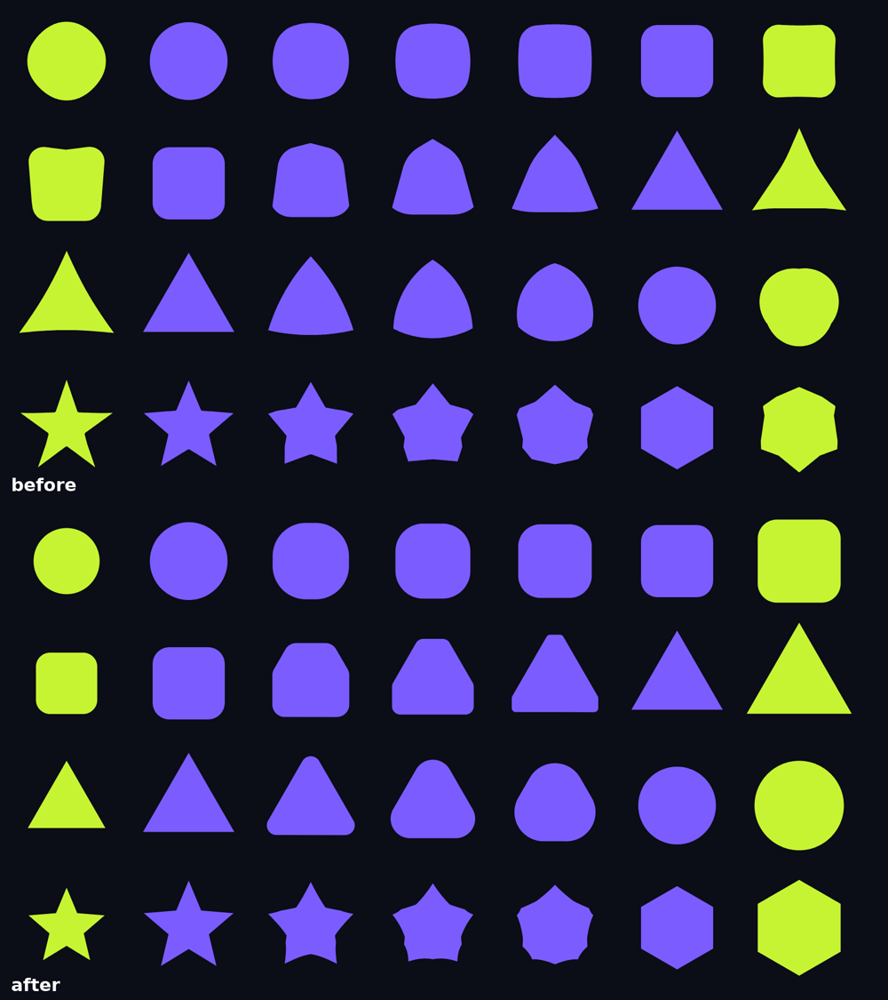
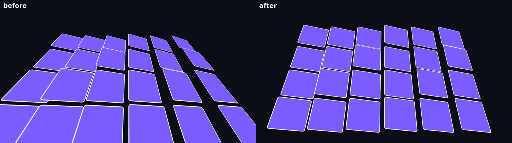
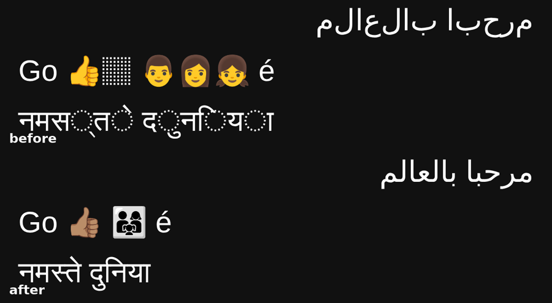

# Fair rounds on random briefs, and what they changed (2026-11-06)

After the KINETIC round ([2026-11-kinetic-three-engines.md](2026-11-kinetic-three-engines.md)), the question was how
givemotion gets clearly better than Remotion and HyperFrames in general, not on one example. That meant three things:
1. Research the gaps (from the other tools' documented features, never their code, and from our own rounds).
2. Fix what generalizes, in the right place (engine, skill, or the user's own taste).
3. Test on briefs nobody here tuned for: drawn at random, written blind, judged blind.

This page has the research, the changes, and two rounds on four random briefs. Round 2 used the engine before the
changes from it; round 3 used the engine after them, on two new random briefs.

## Versions and dates

| Round | Date (UTC) | Briefs | givemotion | Remotion | HyperFrames | Makers | Tools available to makers |
|---|---|---|---|---|---|---|---|
| KINETIC (showcase) | 2026-11-05 | 1 | 0.1.3 (branch) | 4.0.541 | 0.9.15 | Opus 5.5, effort high | shell allowlist, no web, no sub-agents |
| 2 | 2026-11-06 | A, B | 0.1.3 (before the fixes) | 4.0.541 | 0.9.17 | Opus 5.5, effort high | shell allowlist, no web, no sub-agents |
| 3 | 2026-11-06 | C, D | 0.1.3 (after the fixes) | 4.0.541 | 0.9.18 | Opus 5.5, effort high | shell allowlist, no web, no sub-agents |
| 4 | 2026-11-06 | F (E lost to a restart) | 0.1.3 (branch) | 4.0.541 | 0.9.18 | Opus 5.5, effort high | shell allowlist, no web, no sub-agents |
| 5 | 2026-11-06 | E, G | 0.1.3 (branch) | 4.0.541 | 0.9.18 | Opus 5.5, effort high | shell allowlist, no web, no sub-agents |
| 6 | 2026-11-06 | H, I, J | 0.1.3 (branch) | 4.0.541 | 0.9.18 | Opus 5.5, effort high | everything: any shell command, web, sub-agents |
| 7 | 2026-11-06 | K, L, M (two makers per tool each) | 0.1.4 (branch) | 4.0.541 | 0.9.18 | Opus 5.5, effort high | everything: any shell command, web, sub-agents |
| 8 | 2026-11-06 | N, O, P (two makers per tool each; P set to vertical) | 0.1.4 (branch) | 4.0.541 | 0.9.18 | Opus 5.5, effort high | everything: any shell command, web, sub-agents |

Judges: Claude Opus 5.5 at effort high, six per brief, read-only. Machine: one 4-core Linux cloud machine without a
GPU; all makers of a round ran at the same time on it. Remotion projects were made with `create-video` at the same
version and its official agent skills at that version; HyperFrames projects with `hyperframes init --example blank`
and the skills its CLI installs. givemotion "branch" means the development branch at the time of the round (the
packed engine is the one the makers installed; the commit for each round is in the git history of this page).

## How the rounds were made fair

- **Random assignments.** `draw-briefs.py <seed>` draws a genre, a subject, three motion techniques, a format (30%
  vertical) and a length (15-25 s) from fixed lists. The seed is recorded. Nothing was re-drawn.
- **Blind briefs.** A fresh session with no tools, which knows nothing of the three tools, turns each assignment into a
  full brief (palette, fonts, exact copy, beats with times, Must / Must not). The briefs were used as written.
- **Same makers.** Per brief, one fresh headless Claude Code session per tool (Opus 5.5, effort high), each in its own
  folder with only its own tool's official agent docs, the same prompt, a shell allowlist, no web, no subagents (round 6: every tool open to all makers). All
  makers of a round ran at the same time on one 4-core machine without a GPU, which slows the heaviest tool most.
- **Blind judges.** Six fresh Opus 5.5 sessions per brief that can only read their folder. Each sees the three videos as
  A, B and C in a different order (all six orders once): two contact sheets of 40 evenly spread frames, five 1-second
  motion strips at 10 fps, four key frames. Scores 1-10 on brief, spec, motion, craft, errors and overall, a ranking,
  and notes with time stamps.
- **The kit** is in [data/2026-11-random-briefs/](data/2026-11-random-briefs/) (README there), with the briefs, prompts,
  raw scores and stats.
- **What is not equal**, and in whose favour:
  - The fonts offered (Inter, Space Grotesk, Playfair Display, Bebas Neue, JetBrains Mono, Caveat, Nunito) are the ones
    givemotion bundles. Every maker got them as files.
  - The machine's network blocks jsdelivr and remotion.media. HyperFrames got GSAP vendored and Remotion a preinstalled
    Chrome Headless Shell. Remotion's online docs stayed unreachable in rounds 2-5 (round 6 makers had web search and fetch).
  - The shell allowlist refused some harmless chained commands: refusals in round 2 were 3 (givemotion), 14 (Remotion)
    and 6 (HyperFrames).

The comparison video (106 s: every brief's three videos side by side with their numbers, then the scoreboard) is
`compare/out/compare.mp4` in the round folder.

## Round 2: briefs A and B (givemotion before today's fixes)

| | givemotion | Remotion | HyperFrames |
|---|---|---|---|
| **A. "The City Hive"**, a hand-drawn infographic, 23 s: judges (mean of 6) | 6.0 | 6.2 | **8.0** (first for 6 of 6) |
| **B. "Pocketfold"**, a title sequence, 15 s: judges | **7.5** (first for 4) | 7.3 (2) | 6.7 |
| Tokens A / B | **9.3M / 4.1M** | 17.8M / 5.6M | 16.9M / 10.6M |
| Cost A / B | **$6.42 / $2.99** | $9.83 / $3.90 | $9.81 / $5.48 |
| Minutes to a finished video A / B | **32.5 / 11.8** | 38.1 / 13.7 | 42.5 / 19.0 |
| Code written A / B (lines) | **978 / 453** | 2041 / 1304 | 1475 / 994 |
| Render A / B, each tool's own command | **97 s / 15 s** (A with 1 worker, see below) | 105 s / 26 s | 219 s / 39 s |

- **Brief A: HyperFrames by a wide margin.** It was the only one with the tilted "tabletop" map the brief asked for, and
  text left with its beat.
  - givemotion's maker hand-built a 1,000-line ink engine on `gm.onFrame`, because the engine had no boil or ink
    strokes. Its map never tilted.
  - It kept "3 km" on screen into the next beat to satisfy `check`'s reading-time rule, and its closing doodles piled
    onto the hexagon.
  - Its rooftop beat was the richest drawing of the three, and judges called the 9.2 s frame "portfolio-level".
  - Remotion's maker made the same leftover-text mistake.
- **Brief B: close, givemotion first.** It was faithful and clean; its weak spot was the fold (the paths pinched to a
  point). HyperFrames' paths struck through the dollar amounts, which every judge noted.
- **Process.** givemotion's makers were the cheapest and fastest on both briefs and spent only 1.9-9 minutes waiting on
  their tool (37.6 in KINETIC). The brief-A maker looked at 13 frame images, against 36 (Remotion) and 24 (HyperFrames).
- **An engine crash surfaced.** givemotion's brief-A maker could only render with `--workers 1` (fixed since, see below;
  43 s with 4 workers now).

## Round 3: briefs C and D (givemotion after the fixes from KINETIC and round 2)

| | givemotion | Remotion | HyperFrames |
|---|---|---|---|
| **C. "Cleaner Wake"**, a ferry year-in-review, 15 s: judges | **7.5** (first for 3) | 7.3 (2) | 7.2 (1) |
| **D. "ROOFCOMB"**, a beekeeping manifesto, 18 s: judges | 6.0 | **7.7** (first for 5) | 7.3 (1) |
| Tokens C / D | **5.9M / 5.8M** | 9.4M / 8.0M | 7.2M / 9.0M |
| Cost C / D | $4.94 / **$4.47** | $5.95 / $5.08 | **$4.63** / $6.06 |
| Minutes C / D | 21.1 / **18.4** | 22.3 / 19.6 | **17.7** / 23.9 |
| Code C / D (lines) | **557 / 568** | 1543 / 1460 | 1381 / 904 |
| Render C / D | **16 s / 17 s** | 25 s / 25 s | 39 s / 28 s |

- **Brief C: close, givemotion first.** Judges called it the most polished piece with the clearest shared-element cut
  (the battery's fill line becoming the chart baseline). Its weak spot was a counter that rolled through values not in
  the copy.
- **Brief D: givemotion last for all six judges.**
  - The brief's strike-through on "DESERT." never appeared. The maker had written it, and an engine bug kept it at zero
    width (below).
  - The automatic motion blur smeared the rolling digits and a small fast bee into what judges called a glowing blob.
  - The letters of "NEIGHBOR." rode a looping path until they read upside down.
  - Remotion's version was the most complete reading of the brief.

## All four random briefs

| | givemotion | Remotion | HyperFrames |
|---|---|---|---|
| Judges, mean of the four briefs | 6.8 | 7.1 | **7.3** |
| Briefs won | **2** (B, C) | 1 (D) | 1 (A) |
| #1 picks | 7 of 24 | **9 of 24** | 8 of 24 |
| Tokens, all four makers | **25.0M** | 40.8M | 43.7M |
| Cost, all four makers | **$18.82** | $24.76 | $25.98 |
| Minutes, all four makers | **84** | 94 | 103 |
| Code, all four (lines) | **2556** | 6348 | 4754 |
| Render, all four | **145 s** | 181 s | 324 s |

**In short:** givemotion makes the video with the least code, tokens, money and time, and renders it fastest, on
every brief. On quality it won two briefs out of four but came third on average: its losses were large (6.0 twice)
and its wins small.

Both losses trace back to fixable things more than to taste:
- **Engine bugs, found by these rounds and now fixed:**
  - a CSS `scaleX(0)` that a tween could never grow out of;
  - letters split into spans counted as one word each;
  - a render crash.
- **Process:** the givemotion makers looked at the fewest frames and missed what the frames would have shown (a map
  that did not tilt, leftover text, upside-down letters).
- **Missing primitives:** hand-drawn boil and ink.

Round 4 (below) tests the engine with all of these in, on two new random briefs.

## Round 4 (partial)

Two new briefs were drawn (E and F). The container restarted while brief E's makers were running: all three exited
with code 1 and left no video, so E has no result. It was not rerun, to keep the round finished on time.

Brief F (a product launch with a UI demo, a counter and a logo end card), blind judges, mean score:

| Engine | Score |
|---|---|
| Remotion | 7.83 |
| givemotion | 7.0 |
| HyperFrames | 6.33 |

givemotion was again the cheapest and fastest to make and render. The judges' main complaint about givemotion in F
was the same as in D: the automatic motion smear on the rolling counter digits made them hard to read mid-roll. After
the round, the smear on elements that hold text was capped at 0.3 of their font size (`AUTO_BLUR.textCap`, see
`src/render.js`). A rerender of F shows less smear, but digits caught mid-roll are still soft. The A/B in
`docs/NEXT.md` ("motion blur on fast text") is still the next step before deciding if text should be smeared at all.

Overall after 6 briefs (KINETIC, A to D, F): givemotion leads on cost and speed every time and on quality in 3 of 6
(KINETIC, B, C). Remotion leads in D and F, HyperFrames in A. It is not yet ahead on quality across random briefs.

## Round 5 (briefs E rerun and G)

New in the engine since round 4, packed before the makers started: `data-count-roll`, a readable odometer (its own wheel
per digit, clipped to one line, higher digits turn only on a carry, a wheel too fast to follow ticks), and the text
smear cap. Brief E was redrawn as it was (it never ran in round 4); brief G was a fresh random draw (seed in
`data/2026-11-random-briefs/r5/seed-r5.txt`): a kinetic poem about electric ferries with particles, kinetic type and
self-drawing lines. Same harness as before: fresh Opus makers, six blind judges per brief, every letter order once.

| Brief | givemotion | Remotion | HyperFrames |
|---|---|---|---|
| E: marathon infographic (depth, wipes, morphing) | 6.83 (2 firsts) | 6.17 (1) | **7.17** (3) |
| G: electric-ferry kinetic poem | 6.5 (1) | **7.33** (5) | 6.33 (0) |

| Maker cost / time / render | givemotion | Remotion | HyperFrames |
|---|---|---|---|
| E | $8.47, 31.5 min, render 17.7 s | $8.60, 29.8 min, 36.6 s | $10.71, 34.6 min, 41.1 s |
| G | $3.98, 17.4 min, render 19.5 s | $5.38, 16.3 min, 24.9 s | $5.55, 20.9 min, 37.4 s |

What the judges said about givemotion:
- E: every judge said it followed the brief most closely (the low-angle route with drops in depth, the iris on "18",
  the wavy wipe, the medal engraved with the route). It lost points to stray elements: an orange dot sitting inside the
  hero number "42.195", and the medal's ribbon poking in at the top edge before the medal appears.
- G: judged the richest picture (reflection, burst, depth), but its beats ran about 1.3 s behind the brief's times, and
  a slamming word landed on top of the previous word while that one was still dissolving.

Where those belong:
- [skill / `check`] Beats late against the brief: `data-expect` exists for this, but the G maker did not write the
  brief's beat times into it. The audit step should require one `data-expect` per brief beat.
- [engine `check`] Two texts on top of each other during a hand-over (one leaving, one arriving) is not flagged yet,
  and neither is a small shape sitting inside a text's box. Both are measurable and wrong in any style.
- [engine] Motion blur: judges in G liked the blur on the ferry and burst, but not on the word that slammed into
  another. After the round, the smear on any object under 15% of the frame was capped at 0.15 of its smaller side
  (`AUTO_BLUR.shapeCap`), so a fast small thing keeps its shape (the brief D bee keeps its stripes).

Running total after round 5 (8 briefs, counting the KINETIC showcase): givemotion first in 3 (KINETIC, B, C),
Remotion in 3 (D, F, G), HyperFrames in 2 (A, E). givemotion's makers were the cheapest in each of those briefs and its
renders the fastest. It was level with the others on quality, not ahead of them.

## Round 6 (briefs H, I, J): the review loop, every tool open

What changed before this round, from the lesson of rounds 2-5 (fixing the last brief's specific mistakes did not raise
the next brief's score; givemotion's makers used about half the tool calls of the others and looked at half as many of
their own frames, and lost most points to visible mistakes):
- Engine: `givemotion review` writes what a viewer sees (an overview, the frames people read, 1-second motion strips at
  the busy moments and hand-overs), the `check` report and a scoring rubric.
- Skill: direct first (research the genre; write the look, type system, motion language and shot list), build style
  frames, then review twice, with a fresh sub-agent as critic (`references/direction.md`).
- `check`: `stray-mark` and `no-expect`.

The harness changed for every tool alike: no tool limits. Each maker could run any shell command, search and fetch the
web and start sub-agents (`r6/run-maker-open.sh`, `r6/prompt-common-open.txt`). Briefs H and I were drawn (seed in
`r6/seed-r6.txt`) and written before the change and never built before this round; J was a fresh draw
(`r6/seed-r6j.txt`). Versions: givemotion 0.1.3 at this branch, Remotion 4.0.541, HyperFrames 0.9.18; Claude Opus 5.5,
effort high; run on 2026-11-06.

| Brief | givemotion | Remotion | HyperFrames |
|---|---|---|---|
| H: deep-sea product teaser, vertical (match cuts, UI with cursor, kinetic type) | 5.67 (1 first) | **7.33** (3) | 6.83 (2) |
| I: jazz-festival poem (UI with cursor, route map, sketch look) | 7.33 (2) | 6.33 (0) | **8.0** (4) |
| J: recycling manifesto (ambient background, match cuts, route map) | 7.67 (2) | **7.83** (4) | 6.33 (0) |
| Mean | 6.89 | **7.16** | 7.05 |

| Maker cost / time | givemotion | Remotion | HyperFrames |
|---|---|---|---|
| H | $5.77, 22.8 min | **$4.34, 17.2 min** | $6.67, 26.8 min |
| I | $7.11, 27.6 min | **$5.04, 22.5 min** | $8.26, 30.1 min |
| J | $4.98, 18.1 min | **$3.85, 15.6 min** | $4.46, 16.6 min |
| Render H / I / J (each tool's own command, one at a time, no cache) | **17.2 / 37.0 / 19.6 s** | 40.0 / 49.1 / 46.1 s | 31.9 / 57.0 / 46.5 s |

How the makers worked: givemotion's ran `review` about 18-20 times per video, called a fresh critic sub-agent twice,
and looked at 24-29 of their own frames (Remotion's 8-16, HyperFrames' 12-22). No maker used web search. The review
loop cost time and money: in this round givemotion's makers were slower and more expensive than Remotion's on all three
briefs, though within the time the slowest tool took.

What the judges said:
- H (givemotion 5.67 after re-judging with correctly shaped frames, see the correction below): the most faithful build and the best-drawn fish, but its errors score was 5.17. The judges saw
  ghosting and doubled text: the counter "overlapping itself" as it glided, cards "breaking up", smears. That was
  givemotion's automatic motion blur.
- I (7.33): the richest craft (sketchy double-stroke phone, sparkle stars), marked down for a map still clipped to the
  old phone edges at the hand-over and a jittered bundle of lines.
- J (7.67): polished first beat and lock-up, the best hand-over of the three; marked down for a muddy, vignette-like
  map reveal and a morph that passed through a shapeless blob.

Decision after the round: motion blur is off by default. Across rounds 3-6 the judges flagged the automatic smear in
four briefs (D, F, G, H: "a glowing blob", "smeared type", ghosting, doubled text) and credited it in none, even after
it was capped. `--motion-blur auto` turns it on. This was not yet in effect for round 6.

## All ten random briefs (rounds 2-6)

| | givemotion | Remotion | HyperFrames |
|---|---|---|---|
| Judges' overall, mean of 10 (1-10) | 6.80 | **7.13** | 7.02 |
| Briefs won (highest mean) | 2 (B, C) | **5** (D, F, G, H, J) | 3 (A, E, I) |
| Judges ranking it first (60 in all) | 15 | **28** | 17 |
| Tokens, all ten | **77.8M** | 90.2M | 113.1M |
| Cost at list prices, all ten | **$53.04** | $56.13 | $65.59 |
| Maker minutes, all ten | 216 | **210** | 246 |
| Code the makers wrote, all ten | **5,592 lines** | 16,408 lines | 11,962 lines |
| Render time, 9 briefs timed (F was not) | **255 s** | 377 s | 539 s |

givemotion was the cheapest overall and wrote far less code, and its renders were the fastest in every brief timed.
On quality it is behind Remotion and about level with HyperFrames. The engine changed between rounds (each round's
section says how), so this is a running record, not one fixed benchmark. In round 6, with the review loop, givemotion
moved up but stayed behind (6.89 against 7.16 and 7.05 after the correction below).

## Correction: vertical briefs were judged from squashed frames (found 2026-11-06)

The judges' packs (`pack.sh`) scaled every frame to 384x216, 576x324 or 1280x720. Vertical videos (briefs H and M)
reached the judges squashed into landscape frames, for all three tools alike; one judge wrote that the video "shares
the landscape format", another that a band "gets squashed". The first fix fitted each frame inside the landscape box
with its own shape, which left vertical frames at about a third of the size; the second gives portrait videos portrait
boxes of the same area (`pack.sh` now). Briefs H, M and M2 were judged again after each fix, by six fresh judges each
time. The squashed scores are in `r6/squashed-packs/` and `r7/squashed-packs/`, the small-fitted ones in
`r6/fitted-small/` and `r7/fitted-small/`; every table on this page uses the portrait-box scores. No landscape set was
affected.

| Set | squashed | fitted small | portrait boxes (used) |
|---|---|---|---|
| H (givemotion / Remotion / HyperFrames) | 6.33 / 7.5 / 6.17 | 6.0 / 7.83 / 6.17 | 5.67 / 7.33 / 6.83 |
| M | 7.0 / 6.67 / 5.33 | 6.5 / 6.83 / 5.5 | 7.17 / 7.5 / 6.0 |
| M2 | 6.17 / 7.5 / 5.83 | 5.67 / 7.0 / 5.83 | 6.0 / 7.0 / 5.83 |

## Round 7 (briefs K, L, M, two makers per tool each)

What changed before this round:
- Engine: motion blur off by default; `review` reads the brief (`brief.md` next to the page, or `--brief`) and adds
  `beats.png`, every timed beat at its own moments, and a critic prompt for a fresh sub-agent in REVIEW.md.
- Skill: research only what is still open (brand kit, earlier work, references and a detailed brief come first); the
  full loop is for new videos.

Method: three new random briefs (seed in `r7/seed-r7.txt`), each made by **two** independent makers per tool (sets 1
and 2; 18 makers), every tool open to all makers. Each set was judged blind by six judges (36 judges). The first launch
was killed by a machine restart before any video was made and was rerun from scratch with the same briefs
(`r7/run-round7b.sh`). Versions: givemotion 0.1.4 at the development branch, Remotion 4.0.541, HyperFrames 0.9.18.

| Set | givemotion | Remotion | HyperFrames |
|---|---|---|---|
| K: water-cycle launch teaser (squash and stretch, self-drawing lines, kinetic type) | 7.17 (2 firsts) | **7.33** (4) | 6.17 (0) |
| K2 (same brief, second makers) | **7.5** (5) | 6.67 (1) | 6.67 (0) |
| L: deep-sea logo sting (3D depth and parallax, kinetic type, a chart) | **7.67** (4) | 7.17 (1) | 6.83 (1) |
| L2 | **7.67** (4) | 7.33 (2) | 6.33 (0) |
| M: library science explainer, vertical (match cuts, masked reveals, kinetic type) | 7.17 (2) | **7.5** (4) | 6.0 (0) |
| M2 | 6.0 (1) | **7.0** (4) | 5.83 (1) |
| **Mean of six sets** | **7.20** | 7.17 | 6.30 |
| Sets won | 3 | 3 | 0 |
| Judges ranking it first (36) | **18** | 16 | 2 |
| Cost / maker minutes, all six | $38.78 / 188 | **$25.64 / 180** | $31.12 / 195 |

A tie with Remotion at the top (7.20 against 7.17, within the noise), well ahead of HyperFrames. givemotion won every landscape set but one (K) and lost both
vertical sets. Its makers now cost the most: the review passes and the critic sub-agent roughly doubled their
tool calls (55-93 against 42-69) and images viewed (21-38 against 7-18). Render times: see [2026-11-rounds-7-8.md](2026-11-rounds-7-8.md).

What the judges said about givemotion's vertical sets: type far smaller than the brief asked ("fills only about a
third of the width"), a hand-built counter caught as "a jumble of half-rolled digits", ragged band wipes with divider
lines crossing labels, and a near-empty frame at the hand-over. None of the givemotion makers used `data-count-roll`:
the briefs asked for readouts that change value several times ("1 IN 10" to "1 IN 100"), which it did not cover.

Changed after the round: `data-roll` (a readout that changes value at set times, rolling only what changed), and the
critic prompt now names undersized type and half-rolled digits.

## Round 8 (briefs N, O, P, two makers per tool each)

What changed before this round:
- Skill: in 9:16, size headlines to the width; every vertical hold is a phone poster (high contrast, nothing cut by
  the sides, no near-empty hand-over frame).
- Cost: one critic sub-agent on the near-final cut instead of two; `review` makes four motion strips instead of six.
- Judging: portrait videos reach the judges in portrait boxes.
- (`data-roll` was in the engine; no maker used it, as no brief asked for a readout that changes value.)

Three new random briefs (seed in `r8/seed-r8.txt`). None was drawn vertical, so brief P's format was set to 1080x1920
before the brief writer saw it, to test the vertical changes (`forced_vertical` in `r8/assignments-r8.json`; the same
format for every tool). Two makers per tool per brief, six blind judges per set.

| Set | givemotion | Remotion | HyperFrames |
|---|---|---|---|
| N: password-manager title sequence (particles, squash and stretch, kinetic type) | **7.67** (4 firsts) | 6.17 (0) | 7.5 (2) |
| N2 | **7.67** (6) | 6.33 (0) | 6.33 (0) |
| O: budgeting-app title sequence (map/route, self-drawing lines, masked reveals) | 6.83 (1) | **7.33** (3) | 6.5 (2) |
| O2 | **7.83** (5) | 6.83 (1) | 5.83 (0) |
| P: password-manager year in review, vertical (masked reveals, particles, ambient background) | **7.83** (5) | 7.67 (1) | 6.67 (0) |
| P2 | **7.83** (3) | 7.33 (1) | 7.67 (2) |
| **Mean of six sets** | **7.61** | 6.94 | 6.75 |
| Sets won | **5** | 1 | 0 |
| Judges ranking it first (36) | **24** | 6 | 6 |
| Cost / maker minutes, all six | $33.08 / 176 | **$23.53 / 140** | $25.79 / 150 |

givemotion's first clear round win: it led five of the six sets, both vertical ones included, and 24 of 36 judges put
it first. Its makers still cost the most (about 40% more than the cheapest) and took about 26% longer, from the review
and critic passes. Render times (set 1 of each brief, measured on 2026-11-07): givemotion 132 s for the six briefs of
rounds 7 and 8, Remotion 1027 s, HyperFrames 675 s; see [2026-11-rounds-7-8.md](2026-11-rounds-7-8.md).

## All twenty-two judged sets (rounds 2-8)

| | givemotion | Remotion | HyperFrames |
|---|---|---|---|
| Judges' overall, mean of 22 sets | **7.13** | 7.09 | 6.75 |
| Sets won | **10** | 9 | 3 |
| Judges ranking it first (132) | **57** | 50 | 25 |
| Cost at list prices | $125 | **$105** | $122 |
| Maker minutes | 581 | **529** | 592 |
| Code the makers wrote | **12,502 lines** | 33,257 lines | 26,545 lines |

Across all rounds the averages are close, because the early rounds (before the review loop) went to Remotion. The
trend is the point: givemotion moved from last (rounds 2-6) to a tie (round 7) to a clear lead (round 8).

## The research: where givemotion stood

A research pass read the other tools' agent docs (markdown only, code blocks skipped) and CLI help, our docs and
`NEXT.md`, and the earlier rounds. givemotion already did better at:
- **Code size:** 347-453 lines against 763-2041 in these rounds.
- **Determinism:** 1 worker equals N, byte for byte.
- **A broader `check`.**
- **Times tied to spoken words.**
- **Zero dependencies and offline:** the blocked hosts hit both other tools, not givemotion.
- **Working alone:** HyperFrames' docs stop for a person to approve.

The gaps that mattered most, and where each fix belongs:

| Gap | Where | Done |
|---|---|---|
| The agent's loop is slow on heavy pages (38 of 59 min waiting in KINETIC) | engine | yes, see below |
| Continuity: the next beat's set planted early (Remotion's edge twice) | skill | yes |
| Shape morphs look lumpy | engine | yes |
| No way to see a move in one image; no motion expectations | engine | onion skin done; expectations not yet |
| No effects / grade pass | engine tool, looks are taste | not yet (`NEXT.md`) |
| 3D under the camera; holds that drift | engine | yes |
| Token cost | skill | partly (faster loop; references not trimmed) |
| Text measure / international text | engine | grapheme- and script-safe split done |
| Voice, loudness, transcription | engine (optional, local) | not yet |
| Typed props, batch, registry search | engine | not yet |

## What changed (each with a test; `npm test` 146 of 146 after round 6)

Engine, from the KINETIC round and the research:
- **Faster agent loop.**
  - givemotion now prefers a chrome-headless-shell over a generic `CHROME_PATH` (a full Chrome has no BeginFrame
    capture), which made renders 2.8x faster where both exist.
  - `check` draws its internal pictures at half scale (same report, ~3x faster on a heavy page).
- **Morphs.** Convex shapes blend their support points (every in-between convex and balanced). Star-shaped ones blend
  their radius by direction. Overshoot grows the shape instead of denting it. Ends are exact.
  
- **The camera and 3D.** A `preserve-3d` world keeps its depth proportions at any zoom: the perspective becomes P / zoom,
  which projects like a uniform 3D scale and lets Chrome raster at the zoomed size. A 1 s+ shot on the same subject
  rests instead of drifting with its neighbours.
  
- **Text.**
  - `data-split="chars"` keeps graphemes (emoji sequences, letters with marks) and words of joined scripts (Arabic…)
    whole.
    
  - New `check` warnings: `mirrored-text` (text facing away from the camera) and `orphan-word` (a wrapped title with one
    short word alone).
  - `low-contrast` names a passing color in the same hue.
- **Banding.** Frames are captured at JPEG 98: at 92, Chrome's gradient dither was smoothed into 20-80 px bands on dark
  glows (now ~3 px, like lossless frames, for ~3% time).
- **New tools.**
  - `snapshot --trail` (onion skin of a move).
  - `gm.path.stream` (many items flowing along a path).
  - `data-sketch-boil` (hand-drawn lines boil on twos or threes).
  - `data-sketch-ink` (tapered, pressure-varied ink strokes that still draw on).
- **A crash.** On a heavy page with several workers, renders failed with "Another frame is pending": a keep-alive frame
  request could still be pending when the capture asked for its frame. Now one request is in flight at a time, and
  1 worker equals 4 on the page that failed.

From round 2:
- `check` counted letters split into spans as one word each (`short-hold` asked 4 s for a 3-word title). It now decides
  by the gap on screen.
- New `check` warning `text-carried-over`: a big label left on screen through a scene change. Judges punished it in
  givemotion's and Remotion's brief-A videos.
- Skill:
  - Plant the next beat's set early.
  - Effects frame the hero, never cross it.
  - A hold fits inside its beat (never hold text into the next beat to satisfy `short-hold`).
  - Audit each beat against the brief's words before the final render.
  - Mask rises fade in over their first fifth (no stray dashes).
  - Prefer the engine's drawing tools over a hand-built drawing engine.
  - What `onFrame` draws gets no automatic motion blur.

From round 3:
- **A tween now takes the part of the element's CSS transform it animates as its start value.** CSS `scaleX(0)` and a
  tween to `scaleX: 1` stayed at 0, so a strike-through never drew. Centering prefixes such as `translate(-50%, -50%)`
  are kept.
- **`check`:**
  - `upside-down-text`: text turned past ~100°, also while it moves.
  - `missing-glyph`: a character the font lacks, drawn from a fallback face, such as a subscript `₂`.
  - Letter spans that are still flying in when first seen now count as words.
- **`data-expect`.** Timing promises on elements (`in-by`, `gone-by`, `hold`, `in-frame`) that `check` verifies on every
  run. The audit step writes the brief's times there and looks at a frame every second.

Two of these were added after seeing brief A, so round 2's makers could not use them, and round 3 tests them on new
briefs: boil (the brief asked for boiling lines) and ink. Both are general hand-drawn techniques, opt-in, and change
nothing else.

Added after round 4: `data-count-roll` (readable odometer), motion-blur caps (0.3 em on text, 0.15 of the smaller side
on objects under 15% of the frame), `check` `stray-mark` and `no-expect`, `givemotion review`, the direct / style frames /
review-twice loop in the skill (`references/direction.md`), and motion blur off by default after round 6.

## Where the fixes belong (CLAUDE.md, "How to handle feedback")

- **Engine (the frame was wrong, or a tool was missing):**
  - lumpy morphs, a 3D world that stood up when zoomed out, drifting holds, banding, broken emoji and Arabic in splits,
    the beginFrame crash, slow `check`;
  - missing boil, ink, streams and onion skin;
  - `check` miscounting letters.
- **Skill (craft most designers agree on):** continuity, holds inside beats, effects off the hero, mask rises, the brief
  audit, using the engine's tools.
- **User (taste):** none of the round's notes needed an engine default for taste. The judges' "bucket-shaped mark",
  "muted burst" and "doodles piled on the hexagon" are design choices per film.
- **Nowhere:** brief-specific misses (a shockwave 470 px instead of 700, a fold that pinched to a point).
