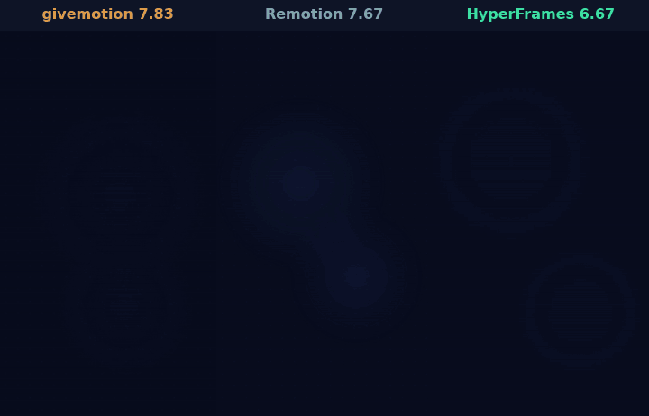

# Rounds 7 and 8: two makers per tool, and givemotion takes the lead (2026-11-06)

Two rounds of the random-brief test with a stronger method: every brief made by **two** independent agents per tool,
every tool open to all makers, six blind judges per set. Round 7 ended in a tie at the top; round 8, after fixes for
vertical videos and a cheaper review loop, was givemotion's first clear win. This page is the report for those two
rounds. The full record of all rounds (method, every brief, raw data, the harness) is
[2026-11-random-briefs.md](2026-11-random-briefs.md); the kit is in
[data/2026-11-random-briefs/](data/2026-11-random-briefs/) (folders `r7/` and `r8/`).

*Round 8, brief P (vertical), first makers of each tool, unedited, with the judges' mean scores. Brief P is a close set
(7.83 / 7.67 / 6.67), chosen as typical rather than as givemotion's widest margin (set N2: 7.67 / 6.33 / 6.33).*

## Versions and conditions

| | Round 7 | Round 8 |
|---|---|---|
| Date (UTC) | 2026-11-06 | 2026-11-06 |
| Briefs | K, L, M (M vertical) | N, O, P (P set to vertical, see below) |
| Makers | 2 per tool per brief (18) | 2 per tool per brief (18) |
| givemotion | 0.1.4 (development branch) | 0.1.4 (development branch; released as 0.1.5) |
| Remotion | 4.0.541 (`create-video@4.0.541`, its official agent skills at that version) | same |
| HyperFrames | 0.9.18 (`hyperframes init --example blank`, the skills its CLI installs) | same |
| Model | Claude Opus 5.5, effort high, for makers and judges | same |
| Tools for makers | everything: any shell command, web search and fetch, sub-agents | same |
| Machine | one 4-core Linux cloud machine, no GPU; all makers of a round at once | same |
| Judges | 6 per set, blind, each sees the three videos of a set in a different letter order | same |

**What each judge sees:** two contact sheets of 40 evenly spread frames, five 1-second motion strips at 10 fps and four
large key frames per video. Judges score brief, spec, motion, craft and errors (1-10), give an overall score and a
ranking, and write notes with time stamps.

**What is not equal, and in whose favour:**
- The fonts offered are the seven givemotion bundles; every maker got them as files.
- The machine cannot reach some CDNs: HyperFrames got GSAP vendored, Remotion a preinstalled Chrome Headless Shell.
- In round 8, none of the three briefs was drawn vertical, so brief P's format was set to 1080x1920 before the brief
  writer saw it, to test the vertical changes. It is the same format for every tool (`forced_vertical` in
  `r8/assignments-r8.json`).
- givemotion's skill was changed between rounds, based on what judges said in earlier rounds. The other tools' docs were
  used as published.

## Results

### Round 7

| Set | givemotion | Remotion | HyperFrames |
|---|---|---|---|
| K: water-cycle launch teaser (squash and stretch, self-drawing lines, kinetic type) | 7.17 | **7.33** | 6.17 |
| K2 (same brief, second makers) | **7.5** | 6.67 | 6.67 |
| L: deep-sea logo sting (3D depth and parallax, kinetic type, a chart) | **7.67** | 7.17 | 6.83 |
| L2 | **7.67** | 7.33 | 6.33 |
| M: library science explainer, vertical (match cuts, masked reveals, kinetic type) | 7.17 | **7.5** | 6.0 |
| M2 | 6.0 | **7.0** | 5.83 |
| **Mean** | **7.20** | 7.17 | 6.30 |
| Sets won | 3 | 3 | 0 |
| Judges ranking it first (36) | **18** | 16 | 2 |

A tie at the top, within the noise. givemotion won three of the four landscape sets and lost both vertical ones.

### Round 8

| Set | givemotion | Remotion | HyperFrames |
|---|---|---|---|
| N: password-manager title sequence (particles, squash and stretch, kinetic type) | **7.67** | 6.17 | 7.5 |
| N2 | **7.67** | 6.33 | 6.33 |
| O: budgeting-app title sequence (map/route, self-drawing lines, masked reveals) | 6.83 | **7.33** | 6.5 |
| O2 | **7.83** | 6.83 | 5.83 |
| P: password-manager year in review, vertical (masked reveals, particles, ambient background) | **7.83** | 7.67 | 6.67 |
| P2 | **7.83** | 7.33 | 7.67 |
| **Mean** | **7.61** | 6.94 | 6.75 |
| Sets won | **5** | 1 | 0 |
| Judges ranking it first (36) | **24** | 6 | 6 |

givemotion led five of six sets, both vertical sets included, and 24 of 36 judges ranked it first.

### Process

| | givemotion | Remotion | HyperFrames |
|---|---|---|---|
| Cost at list prices, round 7 / round 8 | $38.78 / $33.08 | **$25.64 / $23.53** | $31.12 / $25.79 |
| Maker minutes, round 7 / round 8 | 188 / 176 | **180 / 140** | 195 / 150 |
| Code the makers wrote, round 7 / round 8 | **3,534 / 3,376 lines** | 8,439 / 8,410 lines | 7,128 / 7,455 lines |
| Tool calls, round 8 | 420 | 315 | **282** |
| Own frames looked at, round 8 | **172** | 72 | 83 |
| Render time, set 1 of the six briefs (each tool's own command, one at a time, no cache) | **132 s** | 1027 s | 675 s |
| the same without brief L (a heavy 3D page: givemotion 29.3 s, Remotion 805.5 s, HyperFrames 428.9 s) | **103 s** | 222 s | 246 s |

givemotion's makers write the least code and look at their own frames most, and that checking costs: in round 8 they
spent about 40% more than the cheapest makers and took about a quarter longer. Rendering is the other way round:
givemotion rendered every brief fastest, from 2.1x to 27x faster than the slower of the other two. No maker used web search; givemotion's
makers each called a critic sub-agent.

## What the judges said

Notes are quoted from the judges (raw notes are in the harness folders; scores and keys in `r7/` and `r8/`).

**givemotion.** Most often praised for following the brief beat by beat: "follows every beat closely", "the beat
timing follows the brief most closely", "hits every beat", "best-staged of the three". Marked down in round 7's vertical
set for type far smaller than the brief asked ("fills only about a third of the width"), a hand-built counter "a jumble
of half-rolled digits", ragged band wipes and a near-empty frame at a hand-over; in round 8 for hops that were "fairly flat" in one set, and in another for a camera that "loses the TRANSIT pill off
the top of the frame", a route running under a credit and a hyphen used for a minus sign.

**Remotion.** Praised for clean hand-overs and polish: "the crispest handoff edges", "the most legible padlock", "the
best carousel of the three", a "nicer winding river". Marked down for letters overlapping "into an unreadable heap",
"cut-off half-glyphs" in a slot reel, faint ghost rectangles, and an empty screen at a hand-over.

**HyperFrames.** Praised for character and impact: "the most characterful motion", "the boldest burst", "the cleanest
final image". Marked down for framing ("the camera frames the route too low", pills cropped), crack lines drawn over
fallen letters, "the counter still running" past its beat, and a padlock whose body and shackle run "straight through the 0" on the
frame the video ends on.

## What changed in givemotion, and why

| Change | Where | Why (from the judges) |
|---|---|---|
| Motion blur off by default (`--motion-blur auto` turns it on) | engine | the automatic smear read as ghosting and doubled text in four briefs, and was credited in none |
| `givemotion review` reads the brief and adds `beats.png`: every timed beat at its own moments, plus a critic prompt for a fresh sub-agent | engine | most points were lost to beats late, incomplete or in the wrong state, and to leftovers a second look catches |
| Research only what is still open; the full loop is for new videos | skill | the agent should use a brand kit, earlier work and a detailed brief first, and search the web only when that adds something |
| In 9:16, size headlines to the width; every vertical hold is a phone poster | skill | vertical sets were lost to undersized type, low contrast and near-empty hand-over frames |
| One critic pass on the near-final cut; four motion strips instead of six | skill, engine | cost |
| `data-roll`: a readout that changes value at set times, rolling only what changed | engine | makers hand-built changing counters, judged "a jumble of half-rolled digits" (not yet used in a round: no brief in round 8 asked for one) |

## Corrections and caveats

- **Vertical judging.** Before round 8, the judges' packs squashed vertical videos into landscape frames, then (first
  fix) fitted them small. Packs now give portrait videos portrait boxes of the same area. Every vertical set (H, M, M2)
  was judged again; all three versions of their scores are kept and the tables use the portrait ones. Round 7's result
  moved from a narrow givemotion lead to a tie with this correction.
- **Sample size.** Two makers per tool per brief and six briefs over the two rounds. Within one brief, the two makers of the
  same tool differed by up to 1.2 points (givemotion on M and M2: 7.17 and 6.0; on O and O2: 6.83 and 7.83).
- **AI judges look at frames, not motion.** Motion strips at 10 fps stand in for watching. Smoothness between those
  frames is not judged.
- **givemotion was tuned between rounds; the others were not.** That is the point of the exercise, but it means a
  later round of a static tool against an improving one.
- The first launch of round 7 was killed by a machine restart before any video was made; it was rerun from scratch with
  the same briefs.

## Over all rounds

| | givemotion | Remotion | HyperFrames |
|---|---|---|---|
| Judges' overall, mean of all 22 judged sets (rounds 2-8) | **7.13** | 7.09 | 6.75 |
| Sets won | **10** | 9 | 3 |

givemotion was last in rounds 2-6, tied in round 7 and led round 8. The early rounds keep the overall averages close.
