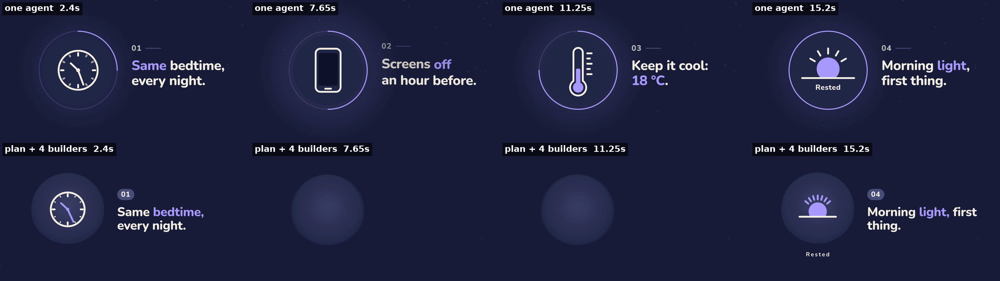

# Plan with a strong model, build with cheap sub-agents? (2026-11-18/19)

A test of one idea about how AI agents should spend their effort when they make a video with givemotion: plan with
the strongest model, build the scenes in parallel with sub-agents on a cheaper, faster model, then check the result
with the strong model. Five small rounds, 14 videos, 20 blind judges. Engine: givemotion 0.1.6 (`a2b0298`).
Models: Claude Opus 5.5, Sonnet 5.5 and Haiku 5.5 in Claude Code 2.1.327.

*The same brief and the same four moments. Top: Opus 5.5 at effort medium, alone. Bottom: Opus 5.5 medium writing the
plan and four Haiku 5.5 sub-agents building one scene each. Its cuts (7.65 s, 11.25 s) are empty discs: each builder made
a scene that starts and ends on nothing, and the seams are what the judges marked down.*

## In short

- **For short videos (12-16 s, 3-4 scenes), building in parallel with cheaper sub-agents did not pay.** It cost
  25-85% more, was not faster, and blind judges preferred the single-agent video in **18 of 20 votes** across five
  comparisons. That held with the main agent at effort high (Sonnet builders) and at effort medium (Haiku builders).
- **The cheap builders were cheap; the main agent was not.** Four Haiku builders cost $0.08, four Sonnet builders
  $0.56-0.93. But the Opus main agent spent as much as, or more than, it spends making the whole video alone: planning,
  briefing builders, assembling and fixing the seams took as many turns as building.
- **Offered as a suggestion, Opus declined it.** With the pattern in the skill as an option, all four makers read it and
  still built one file. Their call was right on this evidence.
- **The bigger lever is the main agent's effort.** On one brief, Opus at medium alone made the video for $1.26 in 6.4
  minutes and scored 8.0, the same as Opus at high alone ($2.34, 12 minutes, 8.0 and 7.75). One run each: a lead for
  the next test, not a result.
- **What changed:** the skill now says to build the video yourself and use a sub-agent for the critic (the one that
  pays), with a short recipe for when a user asks for parallel builders anyway.

These are small rounds with one run per arm per brief: a clear direction, not a benchmark. Long videos (a minute or
more, many independent scenes) were not tested.

## Why this was tested

Research on test-time compute suggests a cheaper model that tries many times against a checker can match a stronger
model, as long as a machine can check the result (tests, a build, a render). Work that only judgment can check is
worth deeper thinking from a stronger model. Applied to video, that suggests a split:

- **Plan** (taste, cannot be checked by a tool): the strongest model, once. Direction, shot list, timing, style.
- **Build** (code, a render shows what is broken): a cheaper model, in parallel, one scene each, looping on `check`
  and stills.
- **Check** (taste again): the strong model looks at the whole and fixes the seams.

The hope was faster, cheaper videos at the same quality, so the question was whether givemotion's agent docs should
suggest this to whatever agent the user runs.

## How it was run

- **Makers.** Each video was made by a fresh headless Claude Code session in its own folder, with givemotion installed
  from the packed repo, the skill pack, the fonts and a brief. The prompt was the one from the random-brief rounds:
  work alone, look at your frames, render to `out/video.mp4`. Sub-agents were allowed (the Agent tool, which can set a
  sub-agent's model and effort). No web, a shell allowlist, edits only inside the folder.
- **Briefs**, written for this test and kept small on purpose:
  - `x` Tidepool app teaser: 12 s, three beats that flow into each other.
  - `y` Night Trains data story: 14 s, four beats (title, map, bar chart, closing line).
  - `z` Four habits for better sleep: 16 s, four separate scenes joined by transitions, same layout in each.
  - `w` Lumen desk lamp product film: 16 s, four scenes with the same drawn lamp in every one.
- **Arms.**
  - **A, baseline:** the skill as it was (it already suggests one critic sub-agent at the end).
  - **B, suggested:** the skill plus a section "Bigger videos: plan once, build scenes in parallel (if your tool has
    sub-agents)". Phrased as a suggestion, only for 3+ scenes, no model names ("your strongest model", "a cheaper,
    faster model"), user instructions win. Text: `data/2026-11-subagents/guidance/arm-B.md`.
  - **F, requested:** arm B's skill, and the prompt asks for the pattern, as a user who wants it would.
  - **G, requested with better guidance:** like F, with the section rewritten from F's judged faults. The main agent
    builds everything that appears in more than one scene and every transition; builders use only the shared colour
    variables and type classes; no empty frames at a cut; `snapshot --transitions` before rendering. Text:
    `guidance/arm-G.md`.
- **Models and effort.**
  - Rounds 1-4: main agent Opus 5.5 at effort high. The sub-agents' model was the main agent's choice: it picked
    Sonnet 5.5 for every scene builder (and the critic) in F and G, and left the critic on Opus in A and B. Sub-agent
    effort was not set.
  - Round 6: main agent Opus 5.5 at effort medium, every sub-agent Haiku 5.5 at effort medium (set in the prompt and
    confirmed in the logs on every sub-agent call).
  - Round 5, a confirmation run of the final text, was stopped (a worker restart, then the scope was cut) and is not
    reported.
- **Judges.** Four fresh Opus 5.5 sessions at effort medium per comparison. Each saw two videos as A and B (each
    video first for two judges), as two contact sheets of 40 frames, five 1-second motion strips at 10 fps and four
    larger key frames: the pack used in the random-brief rounds. They scored brief, spec, motion, craft, errors and
    overall from 1 to 10 and named a winner. These judges ran at medium, the random-brief rounds' at high, so
    compare scores within this report only.
- **Cost and time.** Cost is each session's own `total_cost_usd` at API list prices, main agent and sub-agents
  together. Time is start to finish on a 4-core cloud machine with no GPU. Rounds 1-2 ran four makers at once, rounds
  3-4 and 6 two, so the parallel arms had less competition for the CPU than the baselines and were still not faster.
  Judging cost about $0.57 per judge.

## Results

### Rounds 1-2: the pattern offered as a suggestion (Opus high)

| brief | arm | cost | minutes | sub-agents used |
|---|---|---|---|---|
| x Tidepool | A | $3.52 | 16.1 | critic |
| x Tidepool | B | $3.24 | 17.7 | critic |
| y Night Trains | A | $3.52 | 16.6 | critic |
| y Night Trains | B | $3.95 | 19.4 | critic |
| z sleep | A | $2.34 | 12.0 | critic |
| z sleep | B | $2.97 | 17.2 | critic |
| w lamp | A | $3.12 | 19.6 | critic |
| w lamp | B | $2.80 | 16.9 | critic |

None of the four B makers split the work. In round 1 the first wording said "for 3+ scenes" and the briefs flowed as
one piece, so the agents saw one scene. In round 2 the wording was explicit ("separate scenes joined by transitions")
and the briefs were exactly that, and they still built one file. Their reports describe "one continuous scene" and
"the same lamp stays on screen for all four scenes": they treated the shared objects as one world. B against A moved
-8%, +12%, +27% and -10% in cost, within run-to-run noise. These pairs were not judged, since both arms worked the same
way.

### Rounds 3-4: the pattern requested (Opus high, Sonnet builders)

| brief | arm | cost | minutes |
|---|---|---|---|
| z sleep | A (from round 2) | $2.34 | 12.0 |
| z sleep | F | $3.79 (Opus $2.94 + Sonnet $0.85) | 14.9 |
| z sleep | G | $3.32 (Opus $2.76 + Sonnet $0.56) | 11.8 |
| w lamp | A (from round 2) | $3.12 | 19.6 |
| w lamp | F | $4.12 (Opus $3.53 + Sonnet $0.59) | 21.1 |
| w lamp | G | $5.44 (Opus $4.52 + Sonnet $0.93) | 21.6 |

### Round 6: Opus medium, Haiku builders

| brief | arm | cost | minutes |
|---|---|---|---|
| z sleep | A, Opus medium alone | **$1.26** (Haiku critic $0.01) | **6.4** |
| z sleep | F, Opus medium + 4 Haiku builders | $1.71 (Opus $1.64 + Haiku $0.08) | 9.3 |

### Blind judging

| comparison | one agent (A) | plan + parallel builders | votes for one agent |
|---|---|---|---|
| z sleep, Opus high, Sonnet builders (F) | **8.0** | 7.0 | 4 of 4 |
| w lamp, Opus high, Sonnet builders (F) | **7.75** | 7.25 | 3 of 4 |
| z sleep, Opus high, Sonnet builders, better guidance (G) | **7.75** | 7.0 | 3 of 4 |
| w lamp, Opus high, Sonnet builders, better guidance (G) | **8.0** | 6.5 | 4 of 4 |
| z sleep, Opus medium, Haiku builders (F) | **8.0** | 6.0 | 4 of 4 |
| **all** | | | **18 of 20** |

Mean overall score of each video, from its four judges. Every video had the right size, frame rate and length.

## What the judges saw

The faults they named in the parallel videos were the same every time, and they sit at the seams between scenes:

- **Shared objects that do not match.** The lamp "jumps from frame-left to frame-right and is mirrored" between
  scenes 1 and 2, "so it reads as restaged shots, not one film" (lamp, both F and G). G's guidance said the main agent
  builds anything that appears in more than one scene; the main agent still let scene 1 stage the lamp its own way.
- **Empty frames at the cuts.** "Dead stretches with no copy at 7.2-7.9 s and 11.1-11.8 s" (lamp F); "near-empty
  frames with only a circle (7.6-7.7 s, 11.2-11.3 s), so each scene change feels like a reset" (sleep, Haiku). Each
  builder made a scene that starts and ends on nothing, which is fine alone and breaks the flow when joined.
- **Small differences in taste.** An off-palette blue at 6500K (lamp F), icons smaller inside their rings, "reads more
  like a template", weaker key words ("Same" or "hour" instead of "bedtime" or "off"), a layout "crowded to the left".

The single-agent videos were praised for the opposite: "the lamp stays planted in one spot for the whole film, so it
reads as one piece", "a lilac progress ring that fills across the scenes ... make it read as one continuous video".
Their faults were small and local (a mask clipping a line mid-reveal, a pulse that comes and goes).

## Why it did not pay

1. **The cost is the main agent, and it did not shrink.** Almost all of a session's cost is the main agent re-reading
   its context on every turn: about 40 turns of about 110k tokens (docs, code, frames). Handing scenes away did not cut
   those turns. The main agent still read the docs, planned, wrote the shared files, briefed four builders, assembled
   their scenes, ran `check` and the review, and then fixed seams it had not written. In rounds 3-4 its share alone
   ($2.76-4.52) was the price of a whole single-agent video, and in round 6 it was more ($1.64 against $1.25). The
   builders came on top.
2. **The checker does not check what matters here.** The research rule ("loop the cheap model when a machine can
   check it") assumes the checker decides quality. `check` and a render catch broken frames: text off the frame, a
   blank scene, a missing font. They do not see whether four scenes look like one film. That is judgment over the whole
   video, and splitting the work handed part of it to the cheaper builders.
3. **Short scenes are not independent.** In 16 seconds every scene hands over to the next, shares a layout, an object
   or a colour, and is 4 seconds long. There is little separate work to parallelise and a lot of shared state to keep
   in sync.
4. **It was not faster either.** Four builders ran at once, but the planning before them and the assembly and fixes
   after them ran one at a time, and the builders' own `check` and still runs competed for the same CPU.

So the research rule holds, applied the right way round: the part a machine can check (typing code) was never the
expensive part; the part only judgment can check (one coherent film) is, and it belongs to one strong agent.

## What changed

- `skills/givemotion/references/review.md`, new section "Sub-agents: the critic, not scene builders": build the
  whole video yourself, in one file, with the model you are on, even when it has several scenes; the numbers above and
  why; the sub-agent that pays is the critic (fresh eyes on the frames, not on your intent); if the user asks for
  parallel scene builders, the recipe from arm G: shared `brand.css` and shot list first, the main agent builds
  everything that spans scenes and every transition, one scoped `scenes/<name>.html` per builder with something on
  screen for its whole length, `snapshot --transitions` on every cut.
- `skills/givemotion/SKILL.md`, step 3 of the loop: one sentence pointing there ("Build scenes yourself, not via
  sub-agents"). SKILL.md has a 15,000-byte budget checked by a unit test, so the detail lives in the reference.
- Version 0.1.7 (skill changes only, no engine changes).

## Advice for users, from this test

- Let one agent make the video. For a short piece, its effort setting matters more than how the work is split.
- Medium effort looked like the best value on this brief (same score as high at about half the cost and time). It
  is one run, and the earlier effort test on a harder brief (`2026-11-efforts-showcase.md`) found xhigh clearly ahead,
  so for a video that matters, more effort still helps.
- Keep the critic sub-agent: it cost $0.14-0.37 a video on Opus, and in rounds 1-4 every maker fixed real problems it
  found (holds too short, overlaps at hand-overs, text too small).

## Not tested, worth testing

- **Long videos** (60 s+, 8+ separate scenes), where one agent's context fills up and the scenes may really be
  independent. That is where parallel builders have their best chance.
- **Opus medium against high** for the whole job, on several briefs with two runs each.
- **The critic on a cheaper model.** In round 6 it ran on Haiku for $0.01; whether it finds as much as an Opus critic
  was not measured.

## Raw data

`data/2026-11-subagents/`: the four briefs, the guidance texts of arms B and G, the harness (`setup.sh`,
`run-maker.sh`, the prompts `prompt*.txt`, `judge.sh`, `judge-prompt.txt`, `pack.sh`, `stats.py`, `scores.py`,
`cost.py`), every maker's process numbers (`makers.txt`) and each comparison's judge key, scores and judges' notes
(`judging/`). The makers' transcripts and videos were kept locally.
